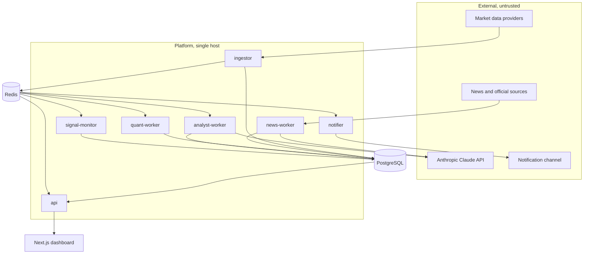
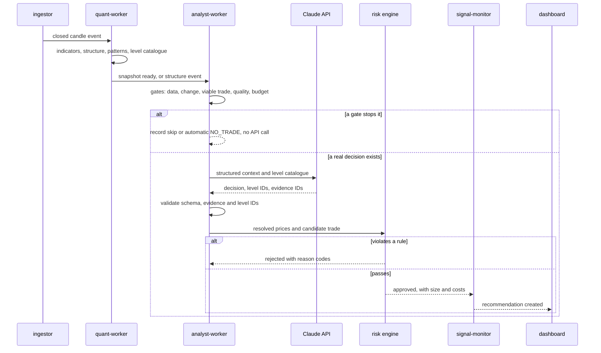

# System Architecture

## Components

### Frontend
Next.js, React, TypeScript and Tailwind.
Responsible for dashboard, charts, configuration and visualization.

### Backend
Python and FastAPI.
Responsible for APIs, orchestration, validation and business logic.

### Market Data Service
Provider adapters, WebSockets, REST polling, candle aggregation and validation.

### Quantitative Engine
Indicators, market structure, patterns and numerical features.

### News Service
Collection, deduplication, source verification, relevance and event extraction.

### AI Analyst
Claude API integration, prompt versioning and structured reasoning.

### Risk Engine
Independent deterministic validation of every proposed trade.

### Backtesting
Historical simulation with realistic execution assumptions.

### Paper Trading
Simulated position lifecycle and performance tracking.

### Infrastructure
PostgreSQL, optional TimescaleDB, Redis and background workers.

## Data Flow
External providers -> ingestion -> validation -> storage -> analysis ->
AI reasoning -> risk validation -> recommendation -> dashboard.

## Architectural Principles
- Provider independence.
- Separation of concerns.
- Explicit data contracts.
- Idempotent event processing.
- UTC timestamps.
- Immutable historical recommendations.
- Observable services.
- Failure isolation.

## Detailed Design

Status: Updated 2026-11-02 for accepted decisions D006 to D010. Requirements come from [21-PROJECT-BRIEF.md](21-PROJECT-BRIEF.md). Decisions are in [17-DECISIONS.md](17-DECISIONS.md).
Folder layout: [23-PROJECT-STRUCTURE.md](23-PROJECT-STRUCTURE.md).

### System Context

The platform is a modular monolith: one Python package with several long-running processes. Separate microservices are not justified for this scope (D011).

### Runtime Processes

| Process | Responsibility | Instances | First needed |
|---|---|---|---|
| `api` | REST, WebSocket gateway, authentication | One or more | Phase 0 |
| `ingestor` | Provider connections, validation, candle and snapshot persistence, gap repair | One per provider, enforced by advisory lock | Phase 1 |
| `quant-worker` | Indicators, market structure, patterns and multi-timeframe snapshots after each closed candle | One per instrument group | Phase 2 |
| `signal-monitor` | Recommendation lifecycle, invalidation, expiry and paper fills | One | Risk and paper phases |
| `news-worker` | Polling, deduplication, classification with the cheaper model | One | News phase |
| `analyst-worker` | Trigger gating, context building, Claude calls, output validation, hand-off to risk | One, with one analysis per instrument at a time | Analyst phase |
| `notifier` | Alert delivery and deduplication | One | Risk phase |

Workers are plain processes consuming Redis Streams. A job-queue library is added only when a real workload needs it (D014).

The ingestor is separate from `api` because a feed inside the web server would duplicate under multiple workers and tie market data to web deployments.

### Decision Flow

Under D009, Python produces every number, Claude makes the judgment, and the risk engine decides what is allowed. Claude is called only after deterministic gates show a real decision exists, as described in [24-AI-COST-STRATEGY.md](24-AI-COST-STRATEGY.md).

NO_TRADE and WAIT are stored recommendations with reasons. They are normal results, not failures.

### Event Catalogue

Delivery is at least once for streams, so every consumer is idempotent. Pub/Sub is used only where a newer value replaces an older one.

| Event | Producer | Consumers | Transport | Idempotency key |
|---|---|---|---|---|
| `market.candle.closed` | ingestor | quant-worker, signal-monitor | Stream | Provider, instrument, timeframe, open time |
| `market.price` | ingestor | api, signal-monitor | Pub/Sub | Latest value wins |
| `market.candle.forming` | ingestor | api | Pub/Sub | Latest value wins |
| `market.status` | ingestor | api, analyst-worker | Pub/Sub, with last value in Redis | Latest value wins |
| `quant.snapshot.ready` | quant-worker | analyst-worker, api | Stream | Instrument, timeframe, close time, feature version |
| `quant.event.detected` | quant-worker | analyst-worker | Stream | Pattern ID |
| `news.classified` | news-worker | analyst-worker, api | Stream | Article cluster |
| `recommendation.created` | analyst-worker | signal-monitor, api, notifier | Stream | Recommendation ID |
| `signal.state_changed` | signal-monitor | api, notifier | Stream | Recommendation, to-state |
| `paper.execution.recorded` | signal-monitor | api | Stream | Execution idempotency key |

The closed-candle event is published only after the database commit. If the process dies between the two, a sweep republishes from the database, and consumers ignore repeats.

The signal monitor uses live prices for speed, then re-checks each closed 1-minute candle. A dropped price update therefore cannot hide a stop or target touch.

### Timing Rules

- All code reads time through an injected `Clock`, shared by live, backtest and paper paths.
- A candle becomes visible at its `close_time`, never before.
- Multi-timeframe joins use `close_time <= decision_time`.
- Backtests do not use `received_at` for backfilled rows, because it reflects the backfill date.
- News becomes visible at the later of `published_at` and `first_seen_at`.
- Timeframe roles are configurable in `timeframe_profiles`. The default is 1D direction, 4H structure, 1H intermediate, 15M setup, 5M confirmation and 1M refinement.

### Failure Behaviour

The rule is to fail closed: when in doubt, produce no new recommendation and say why.

| Failure | Behaviour |
|---|---|
| Provider disconnect | Reconnect with backoff. Status moves to DEGRADED, then STALE. New recommendations stop. Missing candles are repaired by REST |
| Stale or invalid market data | Risk engine rejects. Data reliability score falls. Dashboard warns |
| Redis down | PostgreSQL writes continue. Live dashboard degrades. Closed-candle events replay from the database |
| PostgreSQL down | No recommendations. Ingestor stops persisting, and REST repair runs on recovery |
| News provider down | Analysis continues with news marked unavailable. Claude cannot claim news was checked |
| Claude error, refusal or invalid output | No AI recommendation. Status shows analysis unavailable. Active recommendations stay monitored |
| AI budget exhausted | Analyses are skipped and recorded, and an alert is raised |
| Risk engine error | Treated as a rejection |
| Worker crash | Restart. Unacknowledged stream events are redelivered |
| Notification failure | Retried and recorded. Never blocks the signal lifecycle |
| Computer asleep or off | Everything stops. Wake recovery runs on return, as described under Deployment |

### Reliability Targets

| Measure | Target |
|---|---|
| Closed candle committed after `close_time` | Under 5 s at p95 |
| Gap repair after reconnect | Under 60 s |
| Unrecorded gaps during a soak | Zero |
| Last 1,000 candles from the API | Under 100 ms at p95 |
| Stale-data detection | Within 30 s |

### Deployment

Under D007, everything runs first on the owner's MacBook Air, using Docker Compose on OrbStack.

| Constraint, checked 2026-11-02 | Handling |
|---|---|
| 4.6 GB of 228 GB free | **Blocks Phase 1.** Free at least 20 GB first (T0.15). The local storage profile in [12-DATABASE-DESIGN.md](12-DATABASE-DESIGN.md) halves the database |
| 8 GB memory | Cap PostgreSQL and Redis memory. Run the dashboard as a production build during long runs |
| Sleep when lid closes or the machine idles | For long runs, stay plugged in with the lid open and sleep prevented, using `caffeinate -s` |
| PostgreSQL 14 already on port 5432 | The project uses `127.0.0.1:55432` and `127.0.0.1:56379` |
| OrbStack not running | `make up` checks for it and says so |

What happens to data while the computer is asleep or off:

| Data | After waking |
|---|---|
| Candles | Repaired by REST |
| Funding | Repaired by REST |
| Open interest | Repaired at 5-minute resolution, up to one month back |
| Instrument rules | Re-read. A change during sleep is dated at wake time |
| Spread, mark price, depth | Lost, and recorded as missing |
| Liquidations | Lost |
| News | Feeds usually still list recent items. First-seen time is late, so backtests treat them as seen on waking |
| Paper fills | Reconstructed from 1M candles and labelled |

Wake recovery runs in this order:

1. Detect the gap from a jump between wall-clock and monotonic time, or from a failed connection.
2. Set status to RECOVERING. No new recommendations.
3. Reconnect, then repair candles, funding and open interest.
4. Replay 1M candles in time order, so stops, targets, invalidation and expiry resolve at the time they happened. Fills are marked `reconstructed`.
5. Record the downtime for the coverage report.
6. Once healthy, run one coalesced analysis trigger per instrument, not one per missed candle.

Live forward results will contain these gaps, and reports must show coverage. Moving to an always-on server later needs a region Binance permits. No code should depend on running locally.

Backups, restore tests and retention are defined in [12-DATABASE-DESIGN.md](12-DATABASE-DESIGN.md) and [14-SECURITY.md](14-SECURITY.md).

### Future Execution Isolation

The initial release contains no execution module, no order code and no exchange credentials.

If the owner later authorises live execution, it requires its own decision record and a separate module and process. That module must be disabled by default, accept only risk-approved orders, and require explicit human authorisation. No other module may import it.
