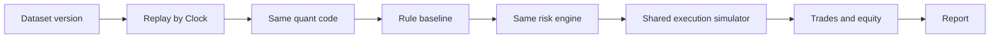

# Backtesting Specification

## Requirements
- Historical candles.
- Historical instrument metadata.
- Historical news with original timestamps.
- Deterministic indicators.
- Strategy simulation.
- Entry and exit simulation.
- Fees.
- Spread.
- Slippage.
- Funding where applicable.
- Position sizing.
- Equity curve.
- Drawdown.
- Trade-level reports.

## Bias Prevention
- No look-ahead bias.
- No future news leakage.
- No survivorship bias.
- No random shuffling of chronological time series.
- No tuning against the final test set.

## Validation
Use chronological training, validation and test periods.
Use walk-forward evaluation.
Keep a final untouched out-of-sample period.

## Metrics
- Total return.
- Net profit/loss.
- Win rate.
- Profit factor.
- Average reward/risk.
- Expectancy.
- Maximum drawdown.
- Sharpe ratio with documented assumptions.
- Sortino ratio where appropriate.
- Trade count.
- Performance by regime and timeframe.

## Important
A profitable backtest is not proof of future profitability.
Simulate conservative fills and realistic execution.
Record configuration and dataset versions.

## Backtesting Methodology

Status: Proposed, 2026-11-02. Requirements: [brief section 13](21-PROJECT-BRIEF.md). Module: `backtesting/`.

### What Is Being Tested

| Component | Tested how |
|---|---|
| Rule baseline: setups, levels, risk rules | Historical backtest and walk-forward |
| Claude-reviewed decisions | Forward only: paper trading plus limited replay |
| Full system | Forward paper trading |

**Claude cannot be backtested honestly on old data.** Its training data contains the outcomes being simulated, so any historical run before its training cutoff leaks the future. API responses cannot be seeded either, and each decision costs money. Claude is therefore evaluated only after `training_cutoff`, stored per model and read from the model's documentation. Masking dates and prices reduces recall but does not remove it, so that is a research option, not evidence.

This follows D009.

### Simulation Design

The engine is event-driven and replays closed candles in time order through an injected `Clock`. Strategy code receives only what would have been visible.

Backtesting and paper trading share one execution simulator and call the same risk engine. Separate implementations would drift, and paper results would stop validating backtests.

### Data

| Dataset | Available from | Used for |
|---|---|---|
| Perpetual candles | 2019-09-08 BTC, 2019-11-27 ETH | Primary dataset. All simulated trades, in both directions (D008) |
| Spot candles | 2017-08-17 | Long-term context. 15M and above are stored locally under D024 |
| Funding | 2019-09-10 BTC, 2019-11-27 ETH | Actual funding costs |
| Spread | From Phase 1 only | Calibrating the spread model |
| Instrument rules | From Phase 1 only | Earlier periods use the first snapshot, labelled as a proxy |
| Open interest, liquidations | From Phase 1B only | Cannot be used in older tests |
| News | From collection start only | First backtests run without news |

Each run uses a `dataset_versions` manifest: instruments, timeframes, range, row counts, known gaps and a content hash. Provider corrections create a new version rather than changing an old one.

A period containing an open gap is excluded from trading in the simulation and listed in the report. Missing data is never filled.

### Timing Rules

- A decision uses only candles with `close_time <= decision_time`.
- Swing points are visible only after their confirmation delay, not at the swing bar.
- Higher timeframes use the last closed candle, never the one in progress.
- Indicator warm-up uses data from before the window start, and no trade occurs until warm-up completes.
- The earliest possible entry is the open of the next 1-minute candle after the decision, plus a configurable latency.

### Fill Rules

Higher-timeframe strategies are simulated on 1-minute candles, so order and fill checks are finer than the signal timeframe.

| Situation | Rule |
|---|---|
| Market entry | Next 1M open, plus half spread and slippage |
| Market entry taken live (demo bot, D044) | The live mid at the decision, rounded against the trade, plus half spread and slippage, at the decision time. In that first minute only the stop is checked, because part of the minute traded before the entry. If that minute cannot absorb the size, the entry is cancelled rather than filled later at an old price. Backtests never use this rule |
| Stop entry | Triggers when the price trades through the level. Fills at the worse of level or open, plus costs |
| Limit entry | Fills only if price trades **through** the limit by at least one tick. A touch does not fill |
| Stop-loss | Fills at the worse of stop or candle open, plus slippage |
| Take-profit | Fills only if price trades through the target by at least one tick |
| Gap through a stop | Fills at the gap open, which can exceed planned risk |
| Gap through a target | Fills at the target, with no credit for the better price |
| Stop and target in the same 1M candle | Stop first. No optimistic assumption is ever made |
| Entry and stop in the same 1M candle | Treated as entered, then stopped |
| Limit entry and target in the same candle | Only the stop is checked in the candle where a limit fills, because the target may have traded before the entry. Added 2026-11-10 for docs/35. No earlier strategy used limit entries |
| Exit at market, decided at a close | Fills at the next candle's open, less half spread and slippage, with the taker fee, like a stop. That candle's stop and targets are not checked, because the position is gone at its open. Added 2026-11-11 for docs/37. No earlier strategy used it |
| Size against liquidity | Order limited to 5% of the 1M candle's volume by default. Any excess is treated as unfilled |
| Expiry | Unfilled orders cancel at expiry. Open positions follow their exit rules |

### Costs

| Cost | Method |
|---|---|
| Fees | Dated `fee_schedules`, taker unless a limit fill is confirmed by the rules above |
| Spread | Recorded distribution by hour and volatility bucket. Before recording begins, a conservative assumption of at least the 90th percentile of recorded values |
| Slippage | Per [08-RISK-MANAGEMENT.md](08-RISK-MANAGEMENT.md), calibrated where data allows |
| Funding | Actual historical rates at each funding time, for positions open at that time. Binance's history has no mark price before March 2023, so the last fill candle's close stands in (`funding_events`). Before 2026-11-10 those events were dropped, so earlier reports charged no funding for 2020 to early 2023 |

Every result is also reported with costs at 1.5× and 2×. A strategy that fails at 1.5× costs is not robust.

### Bias Controls

| Bias | Control | Automated test |
|---|---|---|
| Look-ahead | Clock-gated data access | Corrupting all future candles must not change any past decision |
| Forming candle use | Closed-only types | A forming candle fails type checks |
| Timeframe leakage | As-of joins | A 4H value changes only after its close |
| Future news | Visibility at the later of publication and first-seen | An article is invisible before that time |
| Parameter leakage | Scalers and thresholds fitted on train only | Fit functions refuse test windows |
| Survivorship | BTC and ETH were chosen with hindsight | Stated in every report. A wider universe needs delisted symbols |
| Overfitting | See below | Trial counts stored per run |
| Selection | All trials are recorded, not only the best | Reports show the trial count |
| Unrealistic execution | Conservative fills, liquidity cap, cost stress | Golden tests for each fill rule |
| Shuffling | Time series are never shuffled | Split functions enforce order |

### Periods and Walk-Forward

Data is split strictly by time. The numbers below are for perpetuals: about 86 months to October 2026.

| Period | Length | Purpose |
|---|---|---|
| Train | 24 months | Fit parameters |
| Validate | 6 months | Choose between configurations |
| Test | 6 months | Measure, then roll forward 6 months |
| Embargo | Longest lookback plus longest hold | Separate each period |
| Final holdout | The most recent 12 months | Touched once |

That gives seven walk-forward folds before the holdout. Combined test folds are the main evidence.

**Freeze the holdout start date before any strategy research begins.** Nobody, including an AI assistant, may inspect strategy results on it. The database permits one holdout run per strategy version, and any access is logged. If a strategy fails, a changed strategy needs fresh out-of-sample time, normally from forward paper trading, because the old holdout is spent.

### Overfitting Controls

- State a hypothesis before testing, in the run record.
- Prefer few parameters. Each one needs a reason.
- Count every trial, and record it in `trial_number`.
- Report a deflated Sharpe ratio, or an equivalent adjustment for the number of trials.
- Check parameter stability: nearby values should perform similarly. A sharp peak is rejected.
- Report bootstrap confidence intervals for expectancy.
- Compare with simple benchmarks: buy and hold, and random entries with the same exits and sizing.

### Metrics

| Metric | Definition |
|---|---|
| Net P/L, total return | After all costs |
| Win rate | Wins ÷ (wins + losses + breakevens). Only resolved, filled trades count |
| Expectancy | Mean net R multiple per trade |
| Profit factor | Gross profit ÷ absolute gross loss |
| Average reward/risk | Mean realized win in R ÷ mean realized loss in R |
| Maximum drawdown | Largest peak-to-trough fall in equity, with duration |
| Sharpe | Mean ÷ standard deviation of daily returns × √365, risk-free rate 0, documented in the report |
| Sortino | Same, using downside deviation |
| Trade count | Filled trades, with signals and unfilled orders shown separately |
| Exposure | Share of time in the market |
| Cost share | Costs ÷ gross profit |

All metrics are broken down by instrument, timeframe, direction, market regime and fold. Regimes are defined by rules on trend strength and volatility, using only past data. News category is added once news history exists.

### Probability Calibration

A probability may be shown only if it comes from a calibration model built on out-of-sample outcomes.

- Input: setup quality score. Target: whether the trade reached a win.
- Method: logistic or isotonic calibration, fitted on earlier folds and scored on later ones.
- Minimum: 300 resolved out-of-sample trades, as a proposed starting threshold.
- Report: Brier score and a reliability curve.
- Recalibrate per walk-forward fold, and when the strategy version changes.

Otherwise `probability_status` stays `unavailable`, and the dashboard says so.

### Promotion Gate

Proposed minimum evidence before a strategy moves to paper trading:

- At least 200 out-of-sample trades across folds.
- Positive expectancy, with a bootstrap interval excluding zero.
- Profit factor above 1.2 at 1.5× costs.
- Positive results in most folds, not driven by one period.
- Better than the random-entry benchmark.
- Stable under nearby parameters.

Passing is not proof of future profit. Forward paper trading, on data that did not exist during development, is the real test.

### Reproducibility

Every run stores strategy configuration hash, dataset hash, Git commit, seed, cost model and code version. Re-running with the same inputs must produce identical trades and metrics.

### Report Contents

Each report includes configuration, data range, known gaps, cost assumptions, trial count, folds, metrics, cost stress, benchmark comparison, trade list, equity curve, drawdown analysis, known biases and limitations, and this statement: a profitable backtest is not proof of future profitability.

Results are labelled as simulated.

### Required Tests

- Future-corruption test for look-ahead.
- Golden test for every fill rule, including gaps and same-candle conflicts.
- Fee, spread, slippage and funding reproduce hand calculations.
- Event order is deterministic.
- Same inputs give identical output.
- Holdout cannot run twice.
- Backtest and paper simulator produce identical fills on the same event sequence.
