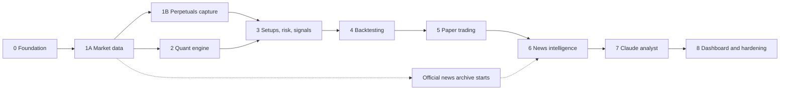

# Development Roadmap

Order accepted by the owner under D010 on 2026-11-02.

## Current Status
Updated 2026-11-02.

- Phase 0 is complete: [phase-0.md](reports/phase-0.md).
- Phases 1A and 1B are code complete, and their long tests are running: [phase-1.md](reports/phase-1.md).
- Phase 2 is complete: [phase-2.md](reports/phase-2.md).
- Phases 3, 4 and 5 are code complete: [phase-3.md](reports/phase-3.md), [phase-4.md](reports/phase-4.md), [phase-5.md](reports/phase-5.md). The strategy has shown no edge, and its evidence gate needs full history.
- Phase 6 is built, and Claude classification waits for an API key: [phase-6.md](reports/phase-6.md).
- Pattern signals, added 2026-11-03: trend-aware candles, chart patterns, a 1H pattern strategy and a history backtest are built. The backtest made money in simulation on BTC and ETH but shows no proven edge. See [27-PATTERN-SIGNAL-PLAN.md](27-PATTERN-SIGNAL-PLAN.md) and D030 to D034.
- Phase 7 started on 2026-11-11 with the AI exit manager in shadow mode (D051): at each 15M close Python checks every open paper trade, asks Claude Haiku 5.5 when a check fires, and scores the advice when the trade closes. It never changes a trade. The owner's Claude API key was set at 04:09 UTC that day, so it now asks Claude, and news classification runs.
- Coins and news, added 2026-11-11 (D052): ZECUSDT and 1000PEPEUSDT joined as the seventh and eighth coins and trade in every account, untested, by the owner's choice. Finnhub crypto news and Binance's announcement stream are built and wait for their keys. Publisher RSS feeds were refused by their terms. News now links to all eight coins. The full trade-plan analyst (docs/28) is still to come. Under D030, Claude trades its own paper account, so it no longer waits for the evidence gate.
- Money plan, added 2026-11-09 (D045): a 1,000 USDT paper account runs all three strategies on all six coins and splits risk between signals by tested evidence, after the six-coin replication study (docs/33). The pre-registered signal score was tested on 2026-11-10 and did not pass (docs/34, D046), so sizing is unchanged. The same work found and fixed missing funding in backtests before March 2023. Next on accuracy: forward paper results per strategy. The score's conditions are recorded with every live signal for that test, and the whole stack starts at login and restarts if it stops (D047).
- Binance demo futures, added 2026-11-10 (D048): the money plan can also trade Binance demo trading with test funds, isolated, at the lowest leverage that fits, with its stop and up to three take-profits held on Binance. It starts once the owner adds demo API keys. Real money stays impossible. See [36-BINANCE-FUTURES-EXECUTION.md](36-BINANCE-FUTURES-EXECUTION.md).
- Binance demo limits, changed 2026-11-11 (D053): at the owner's choice, 2% risk per trade, positions up to 3 times the 100 USDT budget at up to ×3, and a loss stop at 80 USDT that holds until the owner sets new limits. The paper accounts are unchanged.
- Every strategy on Binance demo, added 2026-11-11 (D054): the 4H gap and 15M CHoCH strategy's limit entries now wait on Binance with their stop and targets already placed, so all four strategies trade there. The Bot page shows the Binance demo account only; the paper accounts keep running for comparison.
- News signal, added 2026-11-11 (D055): Finnhub crypto news is live. Python reads each coin's news from Claude's labels by a pre-registered rule ([39-NEWS-SIGNAL.md](39-NEWS-SIGNAL.md)). It is stored beside every signal and at every 4H close to be tested forward.
- News move strategy, added 2026-11-11 (D056): a strong 1H move trades only when the coin's news agrees. It trades on Binance demo and in the paper money plan at the smallest share, untested, by the owner's choice. The price rules alone showed no edge on 2020 to 2025, so any edge must come from the news. See [40-NEWS-MOVE-STRATEGY.md](40-NEWS-MOVE-STRATEGY.md).
- Safety and checks, 2026-11-15 (D071 to D073):
  - The risk engine reads the freshest quote, so busy closes no longer make signals stale.
  - A cap on each direction, at 60% of equity on the real account.
  - The profit lock tested on history: it lowered the mean on every strategy, -0.05R a trade pooled. It stays by its pre-registered rule, and switching it off is recommended to the owner.
  - The orders table no longer shows an expired limit entry as waiting.
- New coins and the 15M rule tested, 2026-11-14 (D069, [42-NEW-COIN-STUDY.md](42-NEW-COIN-STUDY.md)): the daily trend and the 1H pattern are left out on HYPE, and the 15M rule's loose copy on DOGE and HYPE. The loose copy lost on ten coins pooled (-0.11R a trade), and the owner switched it off everywhere on 2026-11-15 (D070). The 15M rule showed no edge (-0.05R, interval includes zero).
- Coin scorecard, added 2026-11-14 (D068): a Coins page with, for each coin and strategy, the published backtest or why it is untested, the live trades of every account, and the entries' quality in R. It also shows each coin's volatility, spread, data gaps and today's signals. Read-only, Python's numbers only.
- Profit lock on Binance, added 2026-11-14 (D066): at 1.5R beyond the entry fill, the bot's stop moves to lock 1R. This was the owner's choice, made with no backtest first. A moved stop still counts the risk at its first stop (D067), so a lock frees no room for more trades in the same direction. A stop the owner moves in the Binance app is kept, after the bot closed the real SOL short when Binance refused its stop beside the owner's.
- Signals page, rebuilt 2026-11-13 (D065): filters by account, coin, strategy, side, decision, result and period, kept in the address. A table shows each signal with what became of its trade, from Binance's fills or the paper simulator's. An entered trade's Chart link opens it on the Bot page's chart, with its entry and exit marked, as the Binance app does. So do the Results tab's completed trades.
- Several trades at once on Binance demo, 2026-11-13 (D061): positions may total 300% of equity, with no single trade above 100%, and trades open at x3 so the room is shared. Before, a 90% cap meant one or two trades filled it, and 40 of 47 signals were cut too small to trade.
- Real account, added 2026-11-13 (D060): the owner's real Binance USDⓈ-M futures wallet trades the money plan beside demo trading. It starts at 1% a trade with a 20% loss stop, and only once the owner runs `binance_live arm`. The bot reads futures only, refuses a key that can withdraw or transfer, and leaves the owner's own positions alone. The Bot page switches between Real and Demo, closes the bot's trades on request, and sees closes made in the Binance app within a minute. Built and tested; it waits for the owner's key. See [36-BINANCE-FUTURES-EXECUTION.md](36-BINANCE-FUTURES-EXECUTION.md).
- More chances to trade, 2026-11-12 (D059): HYPE and NEAR joined, making ten coins. A loose copy of the 15M rule trades at the smallest share. Checking the daily trend all day was tested and not adopted ([41-INTRADAY-TREND.md](41-INTRADAY-TREND.md)). Binance demo trades at 5% a trade.
- Binance demo limits, changed 2026-11-12 (D058): at the owner's choice, 10% risk per trade, with the risk engine's ceiling raised from 2%, and all positions within 80% of equity. A Settings tab on the Bot page changes every limit, each save a logged version.
- Results tab, added 2026-11-12 (D057): the Bot page shows Binance demo's completed trades, rebuilt from Binance's own fills. It covers win rate, profit, R, fees and funding by coin, strategy, side and day, plus a strategy by coin grid, drawdown, streaks and an equity curve.
- 4H gap and 15M CHoCH strategy, added 2026-11-10 (D049): pre-registered in [35-FVG-CHOCH-STRATEGY.md](35-FVG-CHOCH-STRATEGY.md) and run once. It made +0.02R a trade, about zero, and joined the money plan at a half share by its rule.
- Exit rules, tested 2026-11-11 (D050): breakeven, stall and swing-trail exits, pre-registered in [37-EXIT-RULES.md](37-EXIT-RULES.md) and run once. None beat the strategies' own exits, so nothing changed. They are the bar for the AI exit manager (D051, [38-AI-EXIT-MANAGER.md](38-AI-EXIT-MANAGER.md)).
- Demo bot, added 2026-11-07 (D044): the untested 15M rule baseline trades all six coins in a separate 100 USDT paper account, entering at the live price, and the dashboard's Demo bot page draws every entry and exit on the live chart. See [11-PAPER-TRADING.md](11-PAPER-TRADING.md).
- Model forecasts, added 2026-11-05: Kronos runs beside a resampling baseline as unvalidated evidence for Claude, and every forecast is stored and scored. The dashboard's Forecast page draws it with Python's levels, patterns and the analyst plan. Running at setups waits for the paper loop and Phase 7. See [30-MODEL-FORECASTS.md](30-MODEL-FORECASTS.md) and D040.

- Done: repository inspection, provider research, the ten first deliverables and decisions D006 to D028. See [22-REQUIREMENTS-TRACEABILITY.md](22-REQUIREMENTS-TRACEABILITY.md) and [17-DECISIONS.md](17-DECISIONS.md).
- Working method: phases are built in order without waiting for review, and long tests run alongside later work (D028).
- Hosting: test on the owner's Mac, then Railway if Binance accepts its connections (D026).

## Overview

Why this order: the brief's main goal is demonstrable out-of-sample performance. Building risk and backtesting first shows whether any setup has an edge before spending on AI. Claude also needs structure, levels and a risk engine as inputs, and a rule baseline gives it something to be measured against.

The trade-off is that the AI analyst arrives later. If visible AI output is wanted sooner, Claude can run in shadow mode after Phase 3, producing opinions that create no signals.

| Phase | Goal | Brief | Exit gate |
|---|---|---|---|
| 0 Foundation | Reproducible skeleton | 16, 17, 19 | Plan section 10 |
| 1A Market data | Trustworthy spot data and charts | 2, 12 | 72-hour soak |
| 1B Perpetuals capture | Record the trading venue and what cannot be recovered | 2 | Seven days of capture, with downtime reported |
| 2 Quant engine | Correct, reproducible features | 3, 4, 5 | Reference tests pass, and every pattern has written rules and limitations |
| 3 Setups, risk, signals | Deterministic trade proposals | 8, 9, 10, 11 | Worked examples reproduced, all rejection codes tested |
| 4 Backtesting | Evidence | 13 | Reproducible, leakage tests pass, honest report |
| 5 Paper trading | Live validation | 12, 14 | Simulator matches backtest fills. Stable forward run |
| 6 News intelligence | Structured events | 6, 18 | Timestamps preserved, injection tests pass |
| 7 Claude analyst | Reasoning layer | 7, 10, 11, 18 | Adversarial tests pass, budget guards proven, uplift measured against baseline |
| 8 Dashboard and hardening | Completion | 12, 17 | Audit clean, recovery tested |

Long-running collection starts early and keeps running while the computer is on: spread, rules and snapshots from Phase 1A, perpetuals data from Phase 1B, and official news from a small collector.

## Phase 0: Foundation
Detailed tasks: [19-PHASE-0-1-PLAN.md](19-PHASE-0-1-PLAN.md), section 6.

- Prepare this computer.
- Confirm provider terms.
- Finalize data contracts.
- Create project skeleton.
- CI and safety guards.

## Phase 1A: Market Data
Detailed tasks: [19-PHASE-0-1-PLAN.md](19-PHASE-0-1-PLAN.md), section 7.

- Provider adapter.
- WebSocket ingestion.
- Historical candle ingestion.
- Validation.
- Database storage.
- Gap repair and wake recovery.
- Instrument rules and spread capture.
- Live dashboard.

## Phase 1B: Perpetuals Capture
Detailed tasks: [19-PHASE-0-1-PLAN.md](19-PHASE-0-1-PLAN.md), section 7.

- USD-M adapter on two routed connections.
- Perpetual candle backfill.
- Funding, mark price and open interest.
- Liquidation samples.
- Official source archive.

## Phase 2: Quantitative Analysis
- Indicators.
- Multi-timeframe synchronization.
- Market structure.
- Pattern detection.
- Unit tests.

## Phase 3: Setups, Risk and Signals
- Level catalogue.
- Rule baseline.
- Setup quality score.
- Position sizing.
- SL and TP validation.
- Signal lifecycle.
- Alerts.

## Phase 4: Backtesting
- Shared execution simulator.
- Execution assumptions.
- Walk-forward evaluation.
- Out-of-sample reporting.

## Phase 5: Paper Trading
- Simulated positions.
- Live monitoring.
- Downtime reconstruction.
- Performance reporting.

## Phase 6: News Intelligence
- News ingestion.
- Deduplication.
- Relevance.
- Sentiment and event classification.
- Historical timestamp preservation.

## Phase 7: Claude Analyst
Cost controls come first: [24-AI-COST-STRATEGY.md](24-AI-COST-STRATEGY.md).

- Gates, budgets and usage tracking.
- Input construction.
- Prompt versioning.
- Structured response.
- Evidence validation.
- Forward evaluation.
- Cost dashboard.

## Phase 8: Hardening
- Remaining dashboards.
- Security audit.
- Load tests.
- Monitoring.
- Recovery testing.
- Move to an always-on host, if wanted.

## Release Gate
Do not move to the next phase until the previous phase has tests,
documentation and an explicit completion report.

Under D028, a long test such as the 72-hour soak may run alongside the next phase. The report must list it as open, and the phase counts as proven only when it passes.
