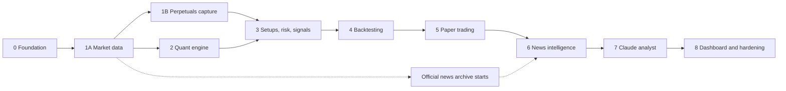

# Development Roadmap

Order accepted by the owner under D010 on 2026-11-02.

## Current Status
Updated 2026-11-02.

- Phase 0 is complete: [phase-0.md](reports/phase-0.md).
- Phases 1A and 1B are code complete, and their long tests are running: [phase-1.md](reports/phase-1.md).
- Phase 2 is complete: [phase-2.md](reports/phase-2.md).
- Phases 3, 4 and 5 are code complete: [phase-3.md](reports/phase-3.md), [phase-4.md](reports/phase-4.md), [phase-5.md](reports/phase-5.md). The strategy has shown no edge, and its evidence gate needs full history.
- Phase 6 is built, and Claude classification waits for an API key: [phase-6.md](reports/phase-6.md).
- Pattern signals, added 2026-11-03: trend-aware candles, chart patterns, a 1H pattern strategy and a history backtest are built. The backtest made money in simulation on BTC and ETH but shows no proven edge. See [27-PATTERN-SIGNAL-PLAN.md](27-PATTERN-SIGNAL-PLAN.md) and D030 to D034.
- Phase 7 has not started. It needs the owner's Claude API key. Under D030, Claude trades its own paper account, so it no longer waits for the evidence gate.
- Money plan, added 2026-11-09 (D045): a 1,000 USDT paper account runs all three strategies on all six coins and splits risk between signals by tested evidence, after the six-coin replication study (docs/33). Next on accuracy: a pre-registered signal score, tested on history before it can change size.
- Demo bot, added 2026-11-07 (D044): the untested 15M rule baseline trades all six coins in a separate 100 USDT paper account, entering at the live price, and the dashboard's Demo bot page draws every entry and exit on the live chart. See [11-PAPER-TRADING.md](11-PAPER-TRADING.md).
- Model forecasts, added 2026-11-05: Kronos runs beside a resampling baseline as unvalidated evidence for Claude, and every forecast is stored and scored. The dashboard's Forecast page draws it with Python's levels, patterns and the analyst plan. Running at setups waits for the paper loop and Phase 7. See [30-MODEL-FORECASTS.md](30-MODEL-FORECASTS.md) and D040.

- Done: repository inspection, provider research, the ten first deliverables and decisions D006 to D028. See [22-REQUIREMENTS-TRACEABILITY.md](22-REQUIREMENTS-TRACEABILITY.md) and [17-DECISIONS.md](17-DECISIONS.md).
- Working method: phases are built in order without waiting for review, and long tests run alongside later work (D028).
- Hosting: test on the owner's Mac, then Railway if Binance accepts its connections (D026).

## Overview

Why this order: the brief's main goal is demonstrable out-of-sample performance. Building risk and backtesting first shows whether any setup has an edge before spending on AI. Claude also needs structure, levels and a risk engine as inputs, and a rule baseline gives it something to be measured against.

The trade-off is that the AI analyst arrives later. If visible AI output is wanted sooner, Claude can run in shadow mode after Phase 3, producing opinions that create no signals.

| Phase | Goal | Brief | Exit gate |
|---|---|---|---|
| 0 Foundation | Reproducible skeleton | 16, 17, 19 | Plan section 10 |
| 1A Market data | Trustworthy spot data and charts | 2, 12 | 72-hour soak |
| 1B Perpetuals capture | Record the trading venue and what cannot be recovered | 2 | Seven days of capture, with downtime reported |
| 2 Quant engine | Correct, reproducible features | 3, 4, 5 | Reference tests pass, and every pattern has written rules and limitations |
| 3 Setups, risk, signals | Deterministic trade proposals | 8, 9, 10, 11 | Worked examples reproduced, all rejection codes tested |
| 4 Backtesting | Evidence | 13 | Reproducible, leakage tests pass, honest report |
| 5 Paper trading | Live validation | 12, 14 | Simulator matches backtest fills. Stable forward run |
| 6 News intelligence | Structured events | 6, 18 | Timestamps preserved, injection tests pass |
| 7 Claude analyst | Reasoning layer | 7, 10, 11, 18 | Adversarial tests pass, budget guards proven, uplift measured against baseline |
| 8 Dashboard and hardening | Completion | 12, 17 | Audit clean, recovery tested |

Long-running collection starts early and keeps running while the computer is on: spread, rules and snapshots from Phase 1A, perpetuals data from Phase 1B, and official news from a small collector.

## Phase 0: Foundation
Detailed tasks: [19-PHASE-0-1-PLAN.md](19-PHASE-0-1-PLAN.md), section 6.

- Prepare this computer.
- Confirm provider terms.
- Finalize data contracts.
- Create project skeleton.
- CI and safety guards.

## Phase 1A: Market Data
Detailed tasks: [19-PHASE-0-1-PLAN.md](19-PHASE-0-1-PLAN.md), section 7.

- Provider adapter.
- WebSocket ingestion.
- Historical candle ingestion.
- Validation.
- Database storage.
- Gap repair and wake recovery.
- Instrument rules and spread capture.
- Live dashboard.

## Phase 1B: Perpetuals Capture
Detailed tasks: [19-PHASE-0-1-PLAN.md](19-PHASE-0-1-PLAN.md), section 7.

- USD-M adapter on two routed connections.
- Perpetual candle backfill.
- Funding, mark price and open interest.
- Liquidation samples.
- Official source archive.

## Phase 2: Quantitative Analysis
- Indicators.
- Multi-timeframe synchronization.
- Market structure.
- Pattern detection.
- Unit tests.

## Phase 3: Setups, Risk and Signals
- Level catalogue.
- Rule baseline.
- Setup quality score.
- Position sizing.
- SL and TP validation.
- Signal lifecycle.
- Alerts.

## Phase 4: Backtesting
- Shared execution simulator.
- Execution assumptions.
- Walk-forward evaluation.
- Out-of-sample reporting.

## Phase 5: Paper Trading
- Simulated positions.
- Live monitoring.
- Downtime reconstruction.
- Performance reporting.

## Phase 6: News Intelligence
- News ingestion.
- Deduplication.
- Relevance.
- Sentiment and event classification.
- Historical timestamp preservation.

## Phase 7: Claude Analyst
Cost controls come first: [24-AI-COST-STRATEGY.md](24-AI-COST-STRATEGY.md).

- Gates, budgets and usage tracking.
- Input construction.
- Prompt versioning.
- Structured response.
- Evidence validation.
- Forward evaluation.
- Cost dashboard.

## Phase 8: Hardening
- Remaining dashboards.
- Security audit.
- Load tests.
- Monitoring.
- Recovery testing.
- Move to an always-on host, if wanted.

## Release Gate
Do not move to the next phase until the previous phase has tests,
documentation and an explicit completion report.

Under D028, a long test such as the 72-hour soak may run alongside the next phase. The report must list it as open, and the phase counts as proven only when it passes.
