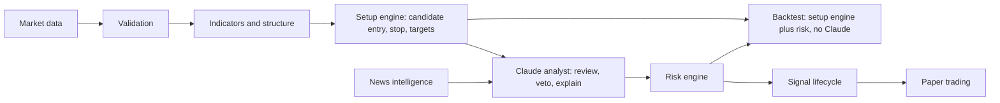
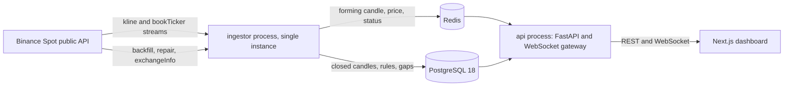

# Architecture Review

Date: 2026-11-02
Status: Draft for owner review. Everything here is a proposal until it is recorded as accepted in [17-DECISIONS.md](17-DECISIONS.md).
Companion plan: [19-PHASE-0-1-PLAN.md](19-PHASE-0-1-PLAN.md).

This is a technical review, not legal advice. Licensing statements quote terms as published on the review date. Confirm them with the provider before any third-party release.

## How This Was Verified

- Read every file in `docs/`, `CLAUDE.md`, all skills in `.claude/skills/` and all agents in `.claude/agents/`.
- Read official provider documentation and legal text where it could be retrieved.
- Ran read-only probes against public endpoints on 2026-11-02: REST calls to Binance, Bybit, OKX, Kraken and Coinbase, and a 30-second live capture of Binance kline and bookTicker streams.
- Queried PyPI and npm for current package versions and Python 3.14 wheel availability.

Deliberately not done: no file was downloaded from `data.binance.vision`. Clause 1.4 of its terms treats access as acceptance, and that is the owner's decision.

Could not be read directly, so these remain unverified or rest on search excerpts (marked "excerpt" below):

| Item | Why |
|---|---|
| Binance separate API terms | Referenced by the Terms of Use, but no published copy was found |
| Binance List of Prohibited Countries | Page body was not served |
| Coinbase Market Data Terms | HTTP 403; excerpts only |
| Bybit terms of service | Request timed out; no market-data clause found |
| FMP pricing and terms | HTTP 403; excerpts only |
| Finnhub pricing and news docs | Client-rendered page; excerpts only |
| CryptoPanic and CoinDesk pricing | Client-rendered pages; no price found |

## 1. Summary

The safety rules and layering in the existing docs are sound. The repository contains no code yet, so nothing needs rewriting. Phases 0 and 1 can start once two owner decisions are made. Three more owner decisions must be settled before the phases after Quant can be designed correctly.

Main findings:

1. **Binance Spot is the best technical fit, conditionally.** It has every required timeframe natively, an explicit closed-candle flag on WebSocket, verified history back to 2017-08-17, and no API key for public data. The recommendation holds only for personal or internal use, in an eligible jurisdiction, from an eligible hosting region.
2. **No major exchange's free feed permits showing data to third parties.** Binance, OKX, Coinbase and Kraken all limit it to personal or internal use, or require permission. If this product will serve other people, data licensing becomes a budget item and must be resolved before release. The adapter layer contains the code impact, but it does not solve the licensing.
3. **The Binance bulk archive carries a stricter licence than expected.** `data.binance.vision` is CC BY-NC-SA 4.0, covers derived charts and models, and excludes commercial products. It is also unnecessary: REST backfill of all required history takes about 20 minutes.
4. **Nobody owns the numbers.** The docs never say what produces entry, stop-loss and take-profit prices. Claude "does not replace the quantitative engine", yet no deterministic strategy module exists. This is the largest gap in the architecture.
5. **Backtesting Claude over past data leaks the future.** A model's training data already contains the prices being "predicted", and sampling parameters are no longer accepted, so runs cannot be reproduced. Any phase relying on Claude in a historical simulation breaks the no-future-data rule.
6. **SELL has no defined meaning on spot.** Spot cannot be shorted without margin, but the requirements include SELL recommendations and funding costs. Funding does not apply to spot at all.
7. **Two datasets required by backtesting cannot be recovered later.** No historical spread or instrument-rule source was found for Binance Spot. Recording must start in Phase 1, even though backtesting comes much later.
8. **TimescaleDB is not justified yet.** All required candles total about 22.6 million rows including perpetuals, roughly 5.6 GB by estimate, growing 2.8 million rows a year. Plain PostgreSQL 18 handles that.
9. **The roadmap builds the AI before knowing whether any strategy has an edge.** Claude comes at Phase 4, backtesting at Phase 6. Moving risk and backtesting first gives evidence before cost.

### Addendum After the Project Brief

The owner supplied the master requirements in [21-PROJECT-BRIEF.md](21-PROJECT-BRIEF.md) on the same date. This review was written before it. Where they differ, the later documents listed in [22-REQUIREMENTS-TRACEABILITY.md](22-REQUIREMENTS-TRACEABILITY.md) apply.

- **Seven timeframes.** 30M is required, taking the spot total to 12.8 million rows. Adding perpetuals gives 22.6 million rows, about 5.6 GB by estimate. TimescaleDB is still not justified.
- **D008 and D009 recommendations changed.** See section 8.1.
- **Derivatives data is in scope.** Funding, open interest and liquidations need Binance USD-M Futures, added as Phase 1B.
- **More data cannot be recovered.** Open-interest history covers one month, and liquidations have no history, so both must be recorded as they happen.
- **Futures streams need two connections.** Binance routes them through `/market` and `/public`, and the legacy path silently drops klines. See [20-API-INTEGRATION-PLAN.md](20-API-INTEGRATION-PLAN.md).
- **Section 3 module names are superseded** by [23-PROJECT-STRUCTURE.md](23-PROJECT-STRUCTURE.md).

### Addendum After Owner Decisions

The owner accepted D006 to D010 on 2026-11-02. Full records are in [17-DECISIONS.md](17-DECISIONS.md).

- **Personal use (D006)** lowers R1 and R15 while it holds, and removes the need for a paid data licence.
- **Local operation (D007)** replaces the always-on server recommendation. It lowers cost, but adds a new blocker: the computer had 4.6 GB free, and full history needs about 5.5 GB. See T0.15 in [19-PHASE-0-1-PLAN.md](19-PHASE-0-1-PLAN.md).
- **Binance perpetuals (D008)** become the primary dataset, not spot.
- **Measured storage** is 245.5 bytes per candle row on synthetic data, confirming the estimate.
- **Provider eligibility remains unconfirmed.** The owner's legal base was not stated, and the prohibited-country list could not be read.
- **Effort and caching advice changed** after reading Anthropic's current guidance. See [24-AI-COST-STRATEGY.md](24-AI-COST-STRATEGY.md).

## 2. Current Status

| Area | State |
|---|---|
| Git | `main` has no commits and no remote. All files are untracked |
| Backend, frontend, infrastructure | Not started. No application code, dependency manifest or Docker files |
| Documentation | 18 specification files, mostly short outlines |
| Claude Code config | 10 project skills, 5 specialist agents |
| `.env.example` | Present, values empty. Scan found no committed secrets |
| Tests, CI | None |

Local toolchain, relevant to Phase 0:

| Tool | Found | Assessment |
|---|---|---|
| Python | 3.10.13 | Too old. NumPy 2.5 needs 3.12 or later, SQLAlchemy 2.1 and pandas 3.1 need 3.11 or later |
| uv | Missing | Install in Phase 0 |
| Node | 24.7.0 | Usable |
| pnpm | 11.17.0 | Usable; npm currently lists 12.16.1 |
| Docker | 29.6.1 | Usable; Postgres and Redis should run here |
| psql | 14.18 | Client only for this project. PostgreSQL 14 reaches end of life on 2026-11-12 |
| redis-server | Missing | Not needed locally if Docker is used |
| gh | Missing | Needed only if GitHub is the chosen remote |

## 3. Architecture Assessment

### 3.1 What To Keep

- Independent deterministic risk engine that Claude cannot override.
- Paper trading only, no execution path.
- Provider adapters with provenance.
- Strict schema validation of AI output.
- Event-driven Claude calls.
- NO_TRADE as a first-class decision.
- Immutable recommendations with revisions recorded separately.

### 3.2 Proposed Pipeline

The current pipeline in `docs/00-PROJECT-OVERVIEW.md` runs Claude before risk, but no component creates a concrete trade. The proposal adds a deterministic setup engine. It produces candidates with explicit entry, stop and targets. Claude reviews, downgrades, vetoes or explains them, but does not originate prices.

Why this matters:

- Backtests become deterministic, cheap and free of model leakage.
- Claude's value can be measured separately, as forward-only uplift over the raw setup engine.
- `D004` ("Python performs calculations") is actually honoured.
- NO_TRADE gets a clear meaning: no candidate passed, or Claude vetoed, or risk rejected.

If the owner prefers Claude to propose levels directly, the system still works, but it cannot be honestly backtested. Evidence would come only from forward paper trading.

### 3.3 Proposed Process Topology

Run a modular monolith: one Python package, two long-running processes. Separate services are not justified for two instruments.

- The ingestor must be a separate process. Running it inside FastAPI duplicates feeds under multiple workers and ties market data to web deploys.
- The ingestor commits closed candles to PostgreSQL first, then publishes. Consumers are idempotent on instrument, timeframe and open time.
- Redis Streams carry closed-candle events, which must not be lost. Pub/Sub carries live price and forming-candle updates, where dropping an old value is fine.
- No job-queue library is needed in Phase 1. Add one when a real background workload appears.

### 3.4 Module Boundaries

| Module | Responsibility | May import |
|---|---|---|
| `core` | Settings, clock, logging, identifiers, errors | Standard library, Pydantic |
| `domain` | Typed models and enums | `core` |
| `providers` | External adapters and capability flags | `core`, `domain` |
| `marketdata` | Normalise, validate, detect gaps, orchestrate ingest | `core`, `domain`, `providers`, `persistence`, `events` |
| `persistence` | Repositories and table definitions | `core`, `domain` |
| `events` | Event envelopes and Redis transport | `core`, `domain` |
| `api` | Routes, schemas, WebSocket gateway, authentication | `core`, `domain`, `persistence`, `events` |
| Later: `risk` | Deterministic validation | `core`, `domain` only. Never `ai` |
| Later: `ai` | Claude integration | `core`, `domain`. Never `risk` internals or any order path |

Enforce these in CI with `import-linter`, which turns "avoid circular dependencies" and "Claude cannot bypass risk" into failing checks.

### 3.5 Cross-Cutting Proposals

- **Separate closed and forming candle types.** `ClosedCandle` and `FormingCandle` should be distinct types. Indicator functions accept only `ClosedCandle`, so rule 10 is enforced by the type checker.
- **Inject a `Clock`.** Live, backtest and paper code read time through one interface, which prevents wall-clock leakage into simulations.
- **Use one execution simulator** for backtesting and paper trading. Two implementations will drift, and paper results would stop validating backtests.
- **Define an as-of rule.** A candle becomes visible only at `close_time`. Multi-timeframe joins use `close_time <= decision_time`. Backtests must not use `received_at` for backfilled rows, because it reflects the backfill date.
- **Treat news timing conservatively.** Use the later of `published_at` and first-seen time. Vendors can backfill or edit timestamps.
- **Label data origin in the schema.** A `data_origin` column (`live`, `backfill`, `synthetic`) makes rule 6 enforceable by constraint and query filter.

## 4. Market-Data Provider Research

### 4.1 Technical Comparison

| | Binance Spot | Bybit V5 Spot | OKX | Kraken Spot | Coinbase |
|---|---|---|---|---|---|
| Public data without key | Yes, verified | Yes, verified | Yes, verified | Yes, verified | Most channels |
| BTC/USDT | Yes | Yes | Yes | Yes | Yes, status online |
| All seven timeframes | Yes | Yes | Not fully confirmed | Yes | WebSocket candles are 5-minute only |
| Closed flag on WebSocket | Yes, `x` | Yes, `confirm` | Not read | None documented | Not documented |
| Closed flag on REST | No; last row is open (verified) | No; returns open candle | Yes, last column (observed) | No; last row uncommitted | Not read |
| REST history | Back to 2017-08-17 (verified) | Not confirmed | Not confirmed | 720 candles only (verified) | 350 rows per call (observed) |
| Rows per REST call | 1000 | 1000, newest first | Not read | 721 observed | 350 observed |
| REST limits | 6000 weight/min per IP; klines cost 2 | 600 requests per 5 s per IP; 403 ban of at least 10 min | Not read | Not read | Not read |
| WebSocket rules | 24 h lifetime; server ping 20 s; 1024 streams; 5 msg/s in; 300 connects per 5 min | Client ping 20 s; 100 args per connection from 2026-11-26 | Ping under 30 s idle; 480 subscribe ops per hour | Not read | Must subscribe within 5 s; heartbeats channel needed |
| Bulk history | Yes, non-commercial licence | Not checked | Not checked | Not checked | Not checked |

Kraken and Coinbase are out on technical grounds. Kraken cannot backfill by API and has no closed flag. Coinbase has no native 1-minute candle stream. Bybit is the strongest technical alternative to Binance.

### 4.2 Licensing Comparison

| Provider | What the text says | Personal research | Third-party product |
|---|---|---|---|
| Binance Terms of Use (ADGM version, effective 2026-05-07) | Clause 27: licence for "non-commercial personal or internal business use". Clause 14.1.2: APIs are "subject to separate API terms and our approval" | Allowed in that wording | Not covered. A regional version bars data feeds and services that profit from Binance data without written consent (excerpt) |
| Binance Vision archive (v1.0, 2026-08-26) | CC BY-NC-SA 4.0. Permits "algorithmic historical backtesting for purely personal non-production research". Clause 2.4 reaches derived charts and models. Clause 4.4 bars commercial financial products. Clause 2.1 extends to "associated endpoints" | Allowed | Barred without an enterprise licence |
| OKX API Agreement (updated 2026-07-28) | Clause 9.4: market data "solely for your own personal, non-commercial trading and account management purposes". Bars display to third parties, analytics platforms, and AI training or evaluation aimed at commercial or third-party use | Allowed | Requires a licence |
| Coinbase Market Data Terms | Bars redistributing or displaying data or derived works outside your organisation. Bars using data to train, validate or benchmark AI models (excerpt) | Unclear; the AI clause is a concern | Barred without consent |
| Kraken | Prior permission needed for "any non-personal commercial use of data from publicly accessible endpoints" (legacy docs page) | Allowed in that wording | Requires permission from marketdata@kraken.com |
| Bybit | No market-data clause could be read | Unknown | Unknown |
| CoinGecko | Paid plans include a commercial licence with required attribution, from $29/month billed yearly. No resale of API access. 1-minute data is described as Enterprise-only, though the page is inconsistent | Allowed | Allowed within limits, but it is not an exchange candle feed |
| CoinAPI | From $79/month. Pricing page does not address licensing | Unknown | Unknown |
| CoinDesk Data | Free tier ended 2026-05-21. Agreement is "for your own internal use only", bars display, and requires deletion at termination (excerpt of agreement dated 2026-04-22) | Paid plan needed | Needs negotiated terms |

Conclusion: for personal or internal use, licensing does not separate Binance from the alternatives. For third-party use, nothing free works, and a written licence is needed from whichever source is chosen.

### 4.3 Verified Binance Behaviour

| Probe | Result | Implication |
|---|---|---|
| Earliest candle, BTCUSDT and ETHUSDT | 2017-08-17 04:00 UTC (1d from 00:00) | Full depth is available by REST |
| REST `klines`, most recent row | Open candle returned; `closeTime` is after server time | REST rows must be filtered, or forming data enters storage. Rule 10 risk |
| Close time format | Ends in `999` ms | Close is inclusive. Next open equals close plus 1 ms |
| Kline stream cadence | About 2.0 s, matches docs | Closed event arrives up to about 2 s after close |
| Kline frame fields | Includes `f`, `L`, `V`, `Q`, `x` | Keep trade IDs and taker volumes; the current model drops them |
| bookTicker rate | About 101/s BTC, 35/s ETH in a 30 s sample | Raw storage would be about 11.8 million rows a day. Aggregate per minute |
| BTCUSDT rules | Tick 0.01, lot step 0.00001, minimum notional 5 | Use `Decimal` and snapshot rules; they change over time |
| Rate limits (`exchangeInfo`) | 6000 weight/min; 300,000 raw requests per 5 min | Backfill is cheap |
| Clock skew from this machine | 22 ms | Fine; monitor it in production |
| Timestamp unit | API default ms; spot archive files use microseconds from 2025-01-01 | A parser bug here shifts dates by a factor of 1000 |

Backfill cost, calculated from the verified start date: about 3,364 days gives 12.8 million rows across two instruments and seven timeframes. That is about 12,800 requests and 25,600 weight. At a self-imposed cap of 1,500 weight per minute (25% of the limit) it completes in about 17 minutes.

### 4.4 Recommendation

**Use Binance Spot public market data as the initial provider, subject to decisions D006 and D007.**

Specifics:

- Use `api.binance.com` and `stream.binance.com`. Avoid `data-api.binance.vision` and `data-stream.binance.vision` for now. They are served from the same domain as the archive, and whether they count as "associated endpoints" under the Vision terms is unclear.
- Do not use the Vision archive. REST backfill is sufficient. If a later need arises, treat it as a separate decision.
- Use no API key. Remove exchange keys from `.env.example`.
- Treat HTTP 451 as a hard stop that raises an alert. Never route around a geographic block with proxies, VPNs or alternate hosts. Rule 7 and `docs/04-MARKET-DATA.md` forbid bypassing access controls.
- Ask Binance in writing before any third-party release, and ask where the "separate API terms" are published.

Eligibility risks:

- Third-party reports consistently tie HTTP 451 to server IP location, with US-based cloud servers blocked and Frankfurt working (excerpt). Choose the hosting region accordingly.
- A July 2026 Binance post names the US, UK, EEA, Hong Kong and Singapore as restricted, but its scope may be limited to one product (excerpt). The authoritative list could not be read.
- Successful probes from this machine prove reachability only, not eligibility.
- The Thai SEC announced blocks on Bybit and OKX effective 2025-06-28 (secondary reports; enforcement not verified). Local rules can decide the alternative as well as the primary.

If D006 selects a third-party product, re-open this section. Candidates would then be a written licence from Binance or Kraken, or a vendor whose terms expressly allow display. CoinAPI and CoinDesk Data would need terms confirmed by their sales teams.

## 5. News Provider Research

| Provider | Findings | Assessment |
|---|---|---|
| NewsAPI | Free plan: 100 requests/day, 24-hour delay, and "cannot be used in a staging or production environment (including internally)". Business: $449/month | Reject. Too expensive for general news, and the free plan does not apply |
| Finnhub | Free: 60 calls/min, licensed for personal use (excerpt). Terms: personal only, no redistribution of data "or derived results", and "All data must be deleted should your subscription to that data ends" | Usable for a personal prototype. The deletion clause makes it a poor base for a historical archive |
| Financial Modeling Prep | `stable/news/crypto-latest` exists. Starter $22, Premium $59, Ultimate $149 per month on annual billing (excerpt). Licence personal; display needs a separate agreement (excerpt) | Leading paid candidate. Confirm which plan includes news and whether stored data survives cancellation |
| CoinDesk Data | Free tier ended. Prices not public. Internal use only, delete on termination | Only if a paid quote is justified |
| CryptoPanic | Free and paid plans exist; limits of 5 to 10 requests/s (excerpt). Plan terms not verified | Evaluate in the news phase |
| Federal Reserve | Official RSS for monetary policy, press, speeches and policy rates | Use. Authoritative for macro events |
| SEC EDGAR | Free, 10 requests/s, declared User-Agent required | Use for regulatory filings |
| BLS | Published schedule for CPI and Employment Situation | Use to build `economic_events` |

Recommendation: select no paid news vendor yet. Start the news phase with official sources, then evaluate FMP against one verified criterion set: crypto coverage, timestamp quality, storage rights after cancellation, and permission to send content to an AI model.

Historical news is a real gap. `docs/10-BACKTESTING.md` requires it, but no affordable, cleanly licensed source was found, and NewsAPI's 5-year history costs $449/month. Plan for first backtests to run without news, and build a forward archive from the day ingestion starts.

## 6. Stack Verification

Versions were read from PyPI and npm on 2026-11-02.

| Component | Version | Notes |
|---|---|---|
| Python | 3.14 | Released 2025-10-07, supported to 2030-10. Wheels confirmed for NumPy, pandas, asyncpg, TA-Lib, pydantic-core and SQLAlchemy on macOS arm64 and Linux x86-64 |
| uvloop | 0.23.0 | No macOS arm64 cp314 wheel. Optional; do not depend on it |
| FastAPI | 0.162.0 | |
| Pydantic | 2.14.2 | |
| SQLAlchemy, Alembic | 2.1.6, 1.20.1 | |
| asyncpg | 0.32.0 | Supports `COPY` for backfill |
| pandas, NumPy | 3.1.0, 2.5.4 | |
| TA-Lib | 0.8.3 | BSD 2-Clause. Wheels bundle the C library, removing the old install problem |
| websockets, httpx | 17.4, 0.28.1 | Direct adapter; `ccxt` is unnecessary and hides raw frames needed for fixtures |
| redis-py | 8.1.0 | |
| anthropic | 2.3.0 | Check against current docs at implementation time |
| pytest, hypothesis | 9.2.0, 6.170.14 | |
| ruff, mypy, import-linter | 0.17.3, 2.4.1, 2.15 | |
| Next.js, React | 16.4.3, 19.3.1 | MIT |
| TypeScript | 7.0.2 | Confirm Next.js compatibility in T0.10 |
| Tailwind, TanStack Query | 4.3.3, 5.105.1 | MIT |
| Lightweight Charts | 5.2.1 | Apache 2.0. Retain the licence and NOTICE. Keep default attribution. Using this library does not conflict with the TradingView scraping ban |
| PostgreSQL | 18.6 | Supported to 2030-11. Native `uuidv7()` |
| Redis | 8 | Tri-licence RSALv2, SSPLv1 or AGPLv3. Unmodified internal use is fine. Revisit if offered as a hosted service |
| TimescaleDB | 2.31.x | Supports PostgreSQL 16 to 18. See section 7 |

Claude API facts for the analyst phase, from the bundled API reference dated 2026-10-06:

- Prices per million tokens: Opus 5.5 $4/$20, Sonnet 5.5 $2/$10, Haiku 5.5 $0.10/$0.50. Batches cost 50% less. Default model is `claude-opus-5-5`; cheaper tiers are an owner decision.
- Structured output uses `output_config.format` and `client.messages.parse()`. Forced `tool_choice` returns 400 on Opus 5.5 and Sonnet 5.5, so do not design around it.
- `temperature`, `top_p` and `top_k` are rejected, so responses cannot be seeded. Store raw responses and replay them; do not re-call to reproduce.
- Citations cannot be combined with `output_config.format`. Evidence references must be project IDs, which Python verifies exist in the input.
- Handle `stop_reason: "refusal"`. Map it to "analysis unavailable", not to a trading decision.
- Keep timestamps and live values after the cache breakpoint, or prompt caching silently stops working.

## 7. Database Review

### 7.1 Assessment

The rules in `docs/12-DATABASE-DESIGN.md` are right: numeric money, UTC, migrations, preserved history. The table list needs correction before implementation.

| Item | Finding | Proposal |
|---|---|---|
| Candle primary key | UUIDs are a poor fit for 12 million natural-key rows | `(provider_id, instrument_id, timeframe, open_time)`. This also keeps conversion to a hypertable possible |
| Forming candles | Storing them in `market_candles` lets them leak into analysis | The table holds closed candles only. Forming state lives in Redis |
| Candle columns | Drops useful provider fields; no raw timestamp despite the rule to preserve it | Add taker buy volumes, first and last trade ID, raw provider open time, `data_origin`, ingest run ID |
| Precision | Not specified | `NUMERIC(38,18)`. PostgreSQL does not store trailing zeros, so wide scale costs little. Measure in T1.1 |
| `market_snapshots` | Undefined | Define as one row per minute: minimum, mean, maximum and last spread, plus mark price and open interest where available |
| `technical_features` | Storing every indicator for every candle is large and derivable | Decide in Phase 2. Persist the exact feature snapshot used by each decision, keyed by code version and parameters |
| Instrument rules | No history kept, yet `docs/10-BACKTESTING.md` requires it | Add `instrument_rule_snapshots` with `valid_from` and `valid_to`, recorded from day one |
| Immutability | A rule, not a mechanism | Use a database role with no UPDATE or DELETE on recommendation, execution and audit tables |
| Event identifiers | "UUID where appropriate" | Use native `uuidv7()`. Time-ordered keys keep inserts local |
| Access control | Single application user implied | Separate roles for migration, ingest and API read |

Tables missing from `docs/12-DATABASE-DESIGN.md`:

| Table | Needed for | Phase |
|---|---|---|
| `instrument_rule_snapshots` | Historical rules | 1 |
| `market_gaps` | Recording every missing range and its repair state | 1 |
| `market_candle_revisions` | Provider corrections without silent overwrite | 1 |
| `ingest_runs` | Provenance | 1 |
| `dataset_versions` | Reproducible backtests. Manifest of range, row count and content hash | 2 |
| `analysis_input_snapshots` | Reproducing exactly what Claude saw | Analyst phase |
| `prompt_versions` | Required by `CLAUDE.md` | Analyst phase |
| `signal_events` | Append-only state transitions | Risk phase |
| `fee_schedules` | Dated fee assumptions. Regular spot rate appears to be 0.1%, but no current dated page was confirmed | Risk phase |
| `alerts` | Delivery and deduplication | Risk phase |
| `audit_log` | Required by `docs/14-SECURITY.md` | Phase 1 for settings and login |

### 7.2 TimescaleDB

Recommendation: do not add it now. Benchmark on real data in T1.17.

- Volume: 22.6 million rows today including perpetuals, and 2.8 million a year. Estimated 250 bytes per row with index gives about 5.6 GB. This is an estimate to be measured, not a measurement.
- Query shape: nearly all reads are a range on one instrument and timeframe, which a B-tree primary key serves directly.
- What Timescale would add: compression, continuous aggregates and retention policies. All three are Community Edition features under the Tiger Data License, which is free to self-host but cannot be sold as a database service.
- Exit path: because `open_time` is in the primary key, a later hypertable conversion stays available.

Revisit if raw trades or order-book data are stored, or if T1.17 misses its latency target.

### 7.3 Retention and Recovery

| Data class | Retention | Recovery |
|---|---|---|
| Candles | Keep | Re-derivable while the provider allows it. Lower backup priority |
| Spread aggregates, rule snapshots | Keep | **Not re-derivable.** Back up |
| Paper trades, recommendations, risk results | Keep | **Not re-derivable.** Back up |
| AI inputs and raw responses | Keep, subject to provider terms | **Not re-derivable.** Back up |
| News | Per provider licence | Add a per-provider flag for deletion on termination |
| Logs, system events | 90 days | Not critical |

Proposed targets until production needs say otherwise: daily `pg_dump`, restore tested in Phase 8, recovery point 24 hours, recovery time 4 hours.

## 8. Decisions

### 8.1 Owner Decisions

| ID | Decision | Recommendation | Blocks |
|---|---|---|---|
| D006 | Who uses this: only you or your organisation, or third parties, free or paid? | Personal or internal for the initial release | Provider choice, authentication, hosting, legal exposure |
| D007 | Where are you legally based, and where will it run? A laptop that sleeps creates data gaps; 24/7 collection needs an always-on host | An always-on small server in an eligible non-US region | Provider eligibility, soak test |
| D008 | What does SELL mean? Long-only spot, USDT-margined perpetuals, or simulated shorts? | Updated after the brief: SELL opens a short on USDT-margined perpetuals, simulated in paper trading, and spot stays the long-history reference. The brief's BUY and SELL, leverage and funding requirements rule out long-only spot | Risk rules, signal semantics, Phase 1B |
| D009 | Who produces entry, stop and target prices? | Updated after the brief: Python catalogues levels, Claude decides and selects levels by ID, and the risk engine validates. A rule baseline uses the same catalogue for backtesting | Quant, analyst, backtest design |
| D010 | Re-order the roadmap? | Yes: Data, Quant, Setup and Risk, Backtest, Paper, News, Claude, Hardening | Phases after 2 |

D006 and D007 block Phase 0 completion. D009 and D010 can wait until Phase 1 ends. D008 should be decided early, because open interest and liquidation history is lost for each day it is not recorded.

### 8.2 Engineering Defaults

These will be adopted when Phase 0 starts unless the owner objects.

| ID | Default |
|---|---|
| D011 | Modular monolith with `api` and `ingestor` processes |
| D012 | PostgreSQL 18. TimescaleDB only if T1.17 justifies it |
| D013 | Ingest all seven timeframes natively. Reconcile aggregated 1m against native as a test, not as the production path. `market_candles` holds closed candles only |
| D014 | Redis Streams for closed candles, Pub/Sub for live updates. No job-queue library in Phase 1 |
| D015 | `Decimal` in domain, database and risk code. Strings for money on the wire. `float64` only inside the indicator engine, crossing one explicit boundary |
| D016 | Hard-code paper mode. Remove exchange keys from `.env.example`. Allow-list provider HTTP to GET on public paths |
| D017 | Use `api.binance.com` and `stream.binance.com`. No Vision archive. Top-of-book only in Phase 1; `subscribe_orderbook()` becomes an optional capability |
| D018 | Python 3.14, uv, pnpm, Docker Compose and Makefile |
| D019 | Phase 1 authentication is one local owner account behind a replaceable dependency. Multi-user waits for D006 |
| D020 | `structlog`, health endpoints and `market.status` in Phase 1. Metrics backend later |
| D021 | `claude-opus-5-5` for reasoning and `claude-haiku-5-5` for classification, as the brief asks for a stronger and a cheaper model |
| D022 | Claude has no tools and no web access in the initial design |
| D023 | Module names follow the brief |

### 8.3 Decisions Needed Later

| Topic | Needed by |
|---|---|
| Stale-data thresholds by timeframe | T1.9 proposes defaults |
| Daily-loss day boundary (UTC midnight proposed) | Risk phase |
| Exposure limits, "duplicate active signal" definition, default signal expiry | Risk phase |
| Whether reward/risk is measured to TP1 or a weighted target, and net of fees | Risk phase |
| Partial exit allocation across TP1 to TP3 | Risk phase |
| Same-candle stop and target ambiguity rule | Backtest phase |
| Claude trigger catalogue and hard daily spend cap | Analyst phase |
| Alert channels | Risk phase |

## 9. Risk Register

Ordered by severity.

| ID | Risk | Likelihood | Impact | Mitigation |
|---|---|---|---|---|
| R1 | Third-party use breaches exchange data terms | High if third-party | Critical | D006. Written licence before any external release |
| R2 | Provider unavailable from chosen location or host | Medium | High | D007. Treat 451 as a hard stop. Keep the adapter replaceable |
| R3 | Claude in historical simulation leaks the future and cannot be reproduced | High if unaddressed | High | D009. Evaluate Claude only forward. Store raw responses |
| R4 | Strategy logic has no owner, so backtests have nothing to test | High | High | D009 |
| R5 | SELL recommendations that cannot be executed on spot | High | High | D008 |
| R6 | Forming candle enters storage or analysis | Medium | High | Filter REST rows. Separate types. Closed-only table |
| R7 | Silent market-data gaps | High | High | Klines have no sequence number, connections end at 24 h, and the final closed frame can be lost. Gap ledger, REST repair, reconciliation sweep |
| R8 | Spread and rule history lost | Certain if not recorded | Medium | Record from Phase 1 |
| R9 | Millisecond and microsecond confusion | Medium | High | Explicit unit in adapters, range check in validator, regression test |
| R10 | Float rounding reaches money calculations | Medium | High | D015. Boundary tests |
| R11 | Paper and backtest simulators diverge | Medium | High | One simulator |
| R12 | News prompt injection | Medium | High | Analyst has no tools. Schema-bound output. Evidence IDs verified by Python. Risk engine is the final gate |
| R13 | Hidden path to live trading | Low | Critical | D016, allow-listed HTTP, a test that fails on signed or order endpoints |
| R14 | Licensed data committed to a public repository | Medium | Medium | Keep the repo private. Ignore data directories. Default test fixtures to small, labelled synthetic data |
| R15 | Providing recommendations to others is regulated advice | Unknown | High | Take legal advice before third-party release |
| R16 | Survivorship and selection bias | Certain | Medium | BTC and ETH are survivors chosen with hindsight. Record it as a limitation in reports. USDT carries peg risk |
| R17 | Single ingestor and host | Medium | Medium | Acceptable initially. Gaps are detected and repaired. Note that spread data cannot be repaired |
| R18 | Claude costs run away | Low | Medium | Hard spend cap, event triggers, cost tracking |
| R19 | Over-building for a two-instrument scope | Medium | Medium | Modular monolith, deferred order book, no unneeded dependencies |
| R20 | Provider API changes | Medium | Low | Watch changelogs. Binance retired v1 endpoints in March 2026, and Bybit changes its argument limit on 2026-11-26 |

## 10. Documentation Defects

To correct in T0.7 and T0.13 unless noted.

| Location | Defect |
|---|---|
| [01-PRODUCT-REQUIREMENTS.md:22](01-PRODUCT-REQUIREMENTS.md#L22) and [09-TRADE-SIGNALS.md:3](09-TRADE-SIGNALS.md#L3) | Four actions exist, but WAIT and NO_TRADE have no lifecycle or storage, despite being first-class |
| [00-PROJECT-OVERVIEW.md:26](00-PROJECT-OVERVIEW.md#L26), [01-PRODUCT-REQUIREMENTS.md:24](01-PRODUCT-REQUIREMENTS.md#L24) and [08-RISK-MANAGEMENT.md:38](08-RISK-MANAGEMENT.md#L38) | Spot scope conflicts with SELL and funding (D008) |
| [17-DECISIONS.md:31](17-DECISIONS.md#L31) and [07-CLAUDE-AI-ANALYST.md:33](07-CLAUDE-AI-ANALYST.md#L33) | Implies Claude emits numbers but no module owns them (D009) |
| [04-MARKET-DATA.md:20](04-MARKET-DATA.md#L20) and [.env.example:5](../.env.example#L5) | Docs say avoid credentials; the template asks for exchange secrets |
| [.env.example:27](../.env.example#L27) | `TRADING_MODE` implies another mode exists |
| [.env.example:28](../.env.example#L28) and [08-RISK-MANAGEMENT.md:9](08-RISK-MANAGEMENT.md#L9) | No stated source of truth for limits: environment or `/api/v1/settings` |
| [04-MARKET-DATA.md:22](04-MARKET-DATA.md#L22) | Model omits provider timestamps required by line 51, and taker volumes |
| [05-TECHNICAL-ANALYSIS.md:29](05-TECHNICAL-ANALYSIS.md#L29) | Volume delta is treated as needing trade data; klines already carry taker buy volume |
| [04-MARKET-DATA.md:43](04-MARKET-DATA.md#L43) | "Sequence gaps" do not exist for klines. Gaps are found from open-time continuity |
| [10-BACKTESTING.md:5](10-BACKTESTING.md#L5) and [10-BACKTESTING.md:11](10-BACKTESTING.md#L11) | Requires instrument history and spread with no identified source |
| [12-DATABASE-DESIGN.md:8](12-DATABASE-DESIGN.md#L8) | `market_snapshots` undefined |
| [13-API-CONTRACTS.md:8](13-API-CONTRACTS.md#L8) | `/signals` has no matching table. Names differ from `trade_recommendations` |
| [13-API-CONTRACTS.md:15](13-API-CONTRACTS.md#L15) | Event names exist with no envelope, ordering or resync rules |
| [02-SYSTEM-ARCHITECTURE.md:35](02-SYSTEM-ARCHITECTURE.md#L35) | "Background workers" undefined |
| [14-SECURITY.md:9](14-SECURITY.md#L9) | "Protect WebSocket connections" is unspecified. Browsers cannot set auth headers on WebSockets |
| [15-TESTING-STRATEGY.md:38](15-TESTING-STRATEGY.md#L38) | Recorded fixtures may be redistribution if the repo is public |
| [.gitignore](../.gitignore) | Missing data files, key files, database dumps and `.claude/settings.local.json` |
| [09-TRADE-SIGNALS.md:3](09-TRADE-SIGNALS.md#L3) | Mixes signal and position states, with no transition table. Fix in the risk phase |

## 11. Sources

Market data:

- Binance: [WebSocket Streams](https://raw.githubusercontent.com/binance/binance-spot-api-docs/master/web-socket-streams.md), [REST API](https://raw.githubusercontent.com/binance/binance-spot-api-docs/master/rest-api.md), [Changelog](https://raw.githubusercontent.com/binance/binance-spot-api-docs/master/CHANGELOG.md), [Filters](https://raw.githubusercontent.com/binance/binance-spot-api-docs/master/filters.md), [Market Data Only](https://raw.githubusercontent.com/binance/binance-spot-api-docs/master/faqs/market_data_only.md), [Public Data](https://github.com/binance/binance-public-data)
- Binance legal: [Vision Dataset Terms](https://data.binance.vision/Binance_Vision-Terms_of_Use.pdf), [Terms of Use, ADGM](https://bin.bnbstatic.com/static/cms/cg08ou2ak0tn7mcplvfg/file/ba68c39023fe6c69d304cce43e2dfd2bdce6e0eebef312e7fbcfecf8a2e6d653.pdf), [regional Terms](https://www.binance.com/us-to/terms), [List of Prohibited Countries](https://www.binance.com/en/legal/list-of-prohibited-countries), [July 2026 post](https://x.com/binance/status/2079901513757987313)
- HTTP 451 reports: [CCXT issue](https://github.com/ccxt/ccxt/issues/15917), [Linode thread](https://www.linode.com/community/questions/23972/linode-and-binancecom)
- Bybit: [WebSocket](https://bybit-exchange.github.io/docs/v5/ws/connect), [Rate limits](https://bybit-exchange.github.io/docs/v5/rate-limit), [Kline REST](https://bybit-exchange.github.io/docs/v5/market/kline), [Kline WebSocket](https://bybit-exchange.github.io/docs/v5/websocket/public/kline)
- OKX: [API Agreement](https://web3.okx.com/help/okx-api-agreement), [API docs](https://www.okx.com/docs-v5/en/)
- Coinbase: [Market Data Terms](https://www.coinbase.com/legal/market_data), [WebSocket overview](https://docs.cdp.coinbase.com/coinbase-app/advanced-trade-apis/websocket/websocket-overview.md), [Channels](https://docs.cdp.coinbase.com/coinbase-app/advanced-trade-apis/websocket/websocket-channels.md)
- Kraken: [OHLC REST](https://docs.kraken.com/api/docs/rest-api/get-ohlc-data/), [OHLC WebSocket](https://docs.kraken.com/api/docs/websocket-v2/ohlc/), [API introduction, legacy](https://docs-legacy.kraken.com/api/docs/guides/global-intro/), [Global Terms](https://www.kraken.com/legal/global-terms)
- Vendors: [CoinGecko pricing](https://www.coingecko.com/en/api/pricing), [CoinAPI pricing](https://www.coinapi.io/products/market-data-api/pricing)
- Regional: [The Block on Thailand](https://www.theblock.co/post/356317/thailand-to-block-bybit-okx)
- Fees: [Binance fee schedule](https://www.binance.com/en/fee/schedule)

News:

- [NewsAPI pricing](https://newsapi.org/pricing), [NewsAPI terms](https://newsapi.org/terms)
- [Finnhub pricing](https://api.finnhub.io/pricing), [Finnhub terms](https://finnhub.io/terms-of-service)
- [FMP pricing](https://site.financialmodelingprep.com/developer/docs/pricing), [FMP terms](https://site.financialmodelingprep.com/terms-of-service), [FMP crypto news](https://site.financialmodelingprep.com/developer/docs/stable/crypto-news), [FMP public-app guidance](https://site.financialmodelingprep.com/insights/platform/can-you-use-fmp-data-in-a-public-app-website-or-client-dashboard)
- [CoinDesk free-tier change](https://data.coindesk.com/blogs/changes-to-coindesk-data-indices-api-free-tier-access), [CoinDesk licence](https://data.coindesk.com/api-licence-agreement), [CoinDesk pricing](https://developers.coindesk.com/pricing/)
- [CryptoPanic guide](https://cph-front-lb.cryptopanic.com/guides/how-to-integrate-the-cryptopanic-api)
- [Federal Reserve feeds](https://www.federalreserve.gov/feeds/feeds.htm), [SEC EDGAR access](https://www.sec.gov/os/accessing-edgar-data), [BLS schedule](https://www.bls.gov/schedule/news_release/current_year.asp)

Stack:

- [PostgreSQL versioning](https://www.postgresql.org/support/versioning/), [PostgreSQL UUID functions](https://www.postgresql.org/docs/current/functions-uuid.html)
- [TimescaleDB editions](https://www.tigerdata.com/docs/about/latest/timescaledb-editions), [TimescaleDB upgrades](https://www.tigerdata.com/docs/deploy/self-hosted/upgrades/major-upgrade)
- [Redis licences](https://redis.io/legal/licenses/), [TA-Lib Python](https://raw.githubusercontent.com/TA-Lib/ta-lib-python/master/README.md), [PEP 745](https://peps.python.org/pep-0745/)
- [Lightweight Charts](https://www.tradingview.com/lightweight-charts/), [licence](https://raw.githubusercontent.com/tradingview/lightweight-charts/master/LICENSE), [NOTICE](https://raw.githubusercontent.com/tradingview/lightweight-charts/master/NOTICE), [releases](https://github.com/tradingview/lightweight-charts/releases)
