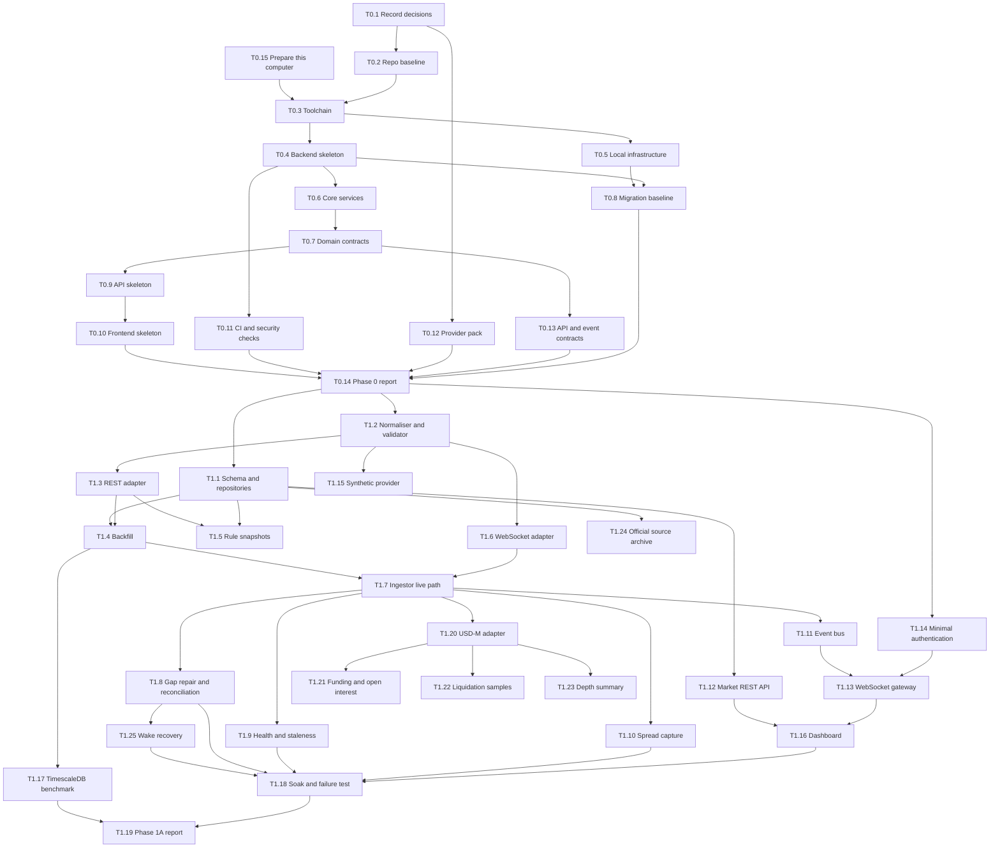

# Phase 0 and Phase 1 Implementation Plan

Date: 2026-11-02
Status: Updated for decisions D006 to D010, accepted 2026-11-02. Requirements are in [21-PROJECT-BRIEF.md](21-PROJECT-BRIEF.md). Findings and rationale are in [18-ARCHITECTURE-REVIEW.md](18-ARCHITECTURE-REVIEW.md).

This plan refines Phases 0 and 1 of [16-DEVELOPMENT-ROADMAP.md](16-DEVELOPMENT-ROADMAP.md).

## 1. Entry Conditions

| Condition | Status | Blocks |
|---|---|---|
| D006 to D010 answered | Done 2026-11-02 | Nothing |
| At least 20 GB of free disk | Open. Under D027 this blocks only the full history download | Full-history T1.4 and T1.20 |
| Owner approves the first commit | Done 2026-11-02: local commits on `develop` (D028) | Nothing |
| D011 to D025 accepted, or objections raised | Done 2026-11-02: adopted | Nothing |
| Owner confirms Binance eligibility for their location | Done 2026-11-02: confirmed by the owner | Nothing |

## 2. Current Status

| Component | Status |
|---|---|
| Specifications | Outlines exist; defects listed in the review, section 10 |
| Application code, tests, CI | None |
| Git | No commits, no remote |
| Local toolchain | Node and pnpm usable. Docker CLI present, but OrbStack is stopped. Python 3.10.13 is too old. uv missing |
| This computer | MacBook Air M1, 8 GB memory, 4.6 GB of 228 GB free. PostgreSQL 14 is using port 5432 |
| Provider research | Done for Binance. Summary pack still to be written in T0.12 |

## 3. Architecture Impact

- Adds a `backend/` Python package with `api` and `ingestor` entrypoints, a `frontend/` Next.js app and `infra/` Compose files.
- Adds candle, provider, instrument, gap, spread and audit tables.
- Adds the closed-versus-forming type split, the injected `Clock`, the event envelope and the `data_origin` label. Every later phase builds on these.
- Adds wake recovery, since the platform runs on the owner's computer.
- Replaces `TRADING_MODE` with a guard that makes paper mode the only possible value.
- Removes exchange keys from `.env.example`.
- Does not touch quant, news, Claude, risk, backtesting or paper-trading modules.

## 4. Implementation Sequence

Priority: P0 is required to exit the phase, P1 is required unless the owner waives it, P2 is valuable but deferrable.
Size: S is under a day, M is one to three days, L is more than three days.



Phase 1 milestones:

| Milestone | Tasks | Meaning |
|---|---|---|
| M1 Historical data | T1.1 to T1.5 | Full verified history in PostgreSQL |
| M2 Reliable live data | T1.6 to T1.10, T1.25 | Live closed candles with gaps detected and repaired, including after sleep |
| M3 Visible data | T1.11 to T1.16 | Dashboard shows live data and data quality |
| M4 Proven under failure | T1.17 to T1.19 | Measured evidence, phase report |
| M5 Phase 1B capture | T1.20 to T1.24 | The trading venue is stored, and data that cannot be recovered is being recorded |

M5 can start once M2 passes, rather than waiting for the dashboard, because each day of delay loses open interest and liquidation data.

## 5. Repository Layout

The full target layout and module dependency rules are in [23-PROJECT-STRUCTURE.md](23-PROJECT-STRUCTURE.md). Module names follow the brief.

## 6. Phase 0 Tasks

### T0.1 Record decisions (P0, S)

Status: Done 2026-11-02. D006 to D028 are recorded.
Depends on: owner answers.
Modifies: `docs/17-DECISIONS.md`.

Acceptance:
- Every accepted decision has date, status, context, options, decision, consequences and revisit conditions.
- Rejected recommendations are recorded with the reason.

Tests: none; document review.

### T0.2 Repository baseline (P0, S)

Depends on: T0.1, owner approval for the first commit.
Modifies: `.gitignore`, `.env.example`, `CLAUDE.md` only if a rule changes.

Work:
- Ignore `data/`, `*.parquet`, `*.dump`, `*.sql.gz`, `*.pem`, `*.key`, `pgdata/`, `.claude/settings.local.json`, `coverage.xml`, `*.tsbuildinfo`.
- Remove `BINANCE_*` and `BYBIT_*` keys. Remove `TRADING_MODE`.
- Add non-secret provider base URL settings.
- Keep the repository private (R14). Choose a remote.

Acceptance:
- `git check-ignore` confirms `.env`, a sample file under `data/`, and `.claude/settings.local.json` are ignored.
- `.env.example` contains no exchange credentials.
- `gitleaks` reports zero findings across history.
- `.claude/skills` and `.claude/agents` are tracked.

Tests: secret scan.

### T0.3 Toolchain (P0, S)

Depends on: T0.2.
Creates: `Makefile`, `.python-version`, `.nvmrc`, `README.md` setup section.

Acceptance:
- On a clean clone, `make bootstrap` installs Python 3.14 through uv and frontend packages through pnpm.
- `make check` runs lint, type checks and tests for both apps.
- The machine's system Python 3.10 is not used.

Tests: `make bootstrap && make check` from a fresh clone.

### T0.4 Backend skeleton (P0, M)

Depends on: T0.3.
Creates: `backend/pyproject.toml`, `backend/uv.lock`, the package tree in section 5, import-linter contracts.

Work:
- Pin dependencies. Add only what Phases 0 and 1 use. Exclude pandas, NumPy, TA-Lib and anthropic until a phase needs them.
- Configure ruff, mypy in strict mode, pytest and import-linter.

Acceptance:
- `mypy --strict` and `ruff` pass.
- `import-linter` fails when `domain` imports `persistence`, shown by a temporary violation.
- `uv.lock` is committed.

Tests: a smoke test imports every package.

### T0.5 Local infrastructure (P0, S)

Depends on: T0.3.
Creates: `infra/docker-compose.yml`, `infra/postgres/init/roles.sql`.

Acceptance:
- `make up` starts PostgreSQL 18 and Redis 8 with health checks, on `127.0.0.1:55432` and `127.0.0.1:56379`, avoiding the PostgreSQL 14 service on port 5432.
- `make up` reports clearly if OrbStack is not running.
- PostgreSQL and Redis have memory caps suited to an 8 GB computer.
- Pinned image digests or exact tags, not `latest`.
- Separate database roles exist for migration, ingest and API read.
- `make down` retains data. `make reset` is the only destructive target.

Tests: `SELECT uuidv7()` succeeds. API role cannot write to a test table.

### T0.6 Core services (P0, M)

Depends on: T0.4.
Creates: `core/settings.py`, `core/clock.py`, `core/logging.py`, `core/errors.py`.

Work:
- Typed settings with `pydantic-settings` and secret redaction.
- `TradingMode` enum whose only member is `PAPER`.
- `Clock` protocol with `SystemClock` and `FixedClock`. UTC only.
- JSON logs through `structlog`, with secret filtering.

Acceptance:
- Startup fails with a clear error when a required setting is missing.
- No code path can represent a live trading mode.
- A timezone-naive datetime is rejected by the shared UTC type.
- Log output contains no configured secret value.

Tests: settings validation, redaction, UTC rejection, a guard test asserting `TradingMode` has one member.

### T0.7 Domain contracts (P0, M)

Depends on: T0.6.
Creates: `domain/instruments.py`, `domain/candles.py`, `domain/events.py`, `data_providers/base.py`.
Modifies: `docs/04-MARKET-DATA.md`, `docs/12-DATABASE-DESIGN.md`.

Work:
- `Timeframe` with duration and alignment rules.
- `ClosedCandle` and `FormingCandle` as distinct frozen types.
- `Instrument` with `instrument_type`, ready for spot now and perpetuals later.
- `DataOrigin`: `live`, `backfill`, `synthetic`.
- `MarketDataProvider` protocol split into required methods and optional capabilities, so `subscribe_orderbook()` is not forced on every adapter.
- Fix the documentation defects for market data and schema.

Acceptance:
- `mypy` rejects passing a `FormingCandle` where a `ClosedCandle` is required, shown by a typing test.
- Prices and volumes are `Decimal`. Building a candle from `float` raises an error.
- Models are immutable.

Tests: construction, invalid input, boundary times for all seven timeframes, typing test.

### T0.8 Migration baseline (P0, S)

Depends on: T0.4, T0.5.
Creates: `backend/alembic.ini`, `backend/migrations/`.

Acceptance:
- `alembic upgrade head` and `downgrade base` both run cleanly on an empty database.
- Naming conventions are set, so constraint names are deterministic.
- Migrations run under the migration role only.
- `docs/schema/schema-v0.sql` loads on PostgreSQL 18 with its native `uuidv7()`, and the constraint checks pass. The earlier run used PostgreSQL 14 with a substitute function.

Tests: integration test applies and reverses migrations.

### T0.9 API skeleton (P0, M)

Depends on: T0.7.
Creates: `api/app.py`, `api/routers/health.py`, `api/errors.py`, `entrypoints/api.py`.

Acceptance:
- `GET /api/v1/health` reports liveness, and readiness including database and Redis.
- All errors use one JSON structure with a code, message and request ID.
- OpenAPI is served and exported to a committed file.
- Only configured origins pass CORS.

Tests: health with dependencies up and down, error format, CORS.

### T0.10 Frontend skeleton (P0, M)

Depends on: T0.9.
Creates: `frontend/` app, `frontend/src/lib/api/`, generated API types.

Acceptance:
- A status page shows backend health through TanStack Query.
- API types are generated from the OpenAPI file with `openapi-typescript`, and CI fails if they drift.
- TypeScript is pinned to 5.9.3. Version 7 was not adopted, because the Next.js and ESLint tooling depends on the JavaScript compiler API and there was no reason to take that risk at this stage.
- The built bundle contains no secret and no server-only variable.
- UI components hold no business logic.

Tests: type check, lint, one component test, a bundle secret scan.

### T0.11 CI and security checks (P1, M)

Depends on: T0.4. Runs locally through `make check` until a remote exists.
Creates: `.github/workflows/ci.yml` if GitHub is chosen, `.pre-commit-config.yaml`.

Acceptance:
- Pipeline runs lint, types, unit tests, integration tests, `gitleaks`, `pip-audit` and `pnpm audit`.
- A deliberately committed fake key fails the check.

Tests: the pipeline itself.

### T0.12 Provider verification pack (P0, S)

Depends on: T0.1.
Creates: `docs/providers/binance-spot.md`, `backend/tests/fixtures/binance_spot/`, a frame-recording script.

Work:
- Record review section 4.3 results as the behaviour contract, including date, endpoint and sample.
- Record the terms relied on, with version and date, and the D006 and D007 outcome.
- Ask Binance where its separate API terms are published.
- Capture minimal real frames for private use only, since D006 selected personal use, and keep the repository private. Labelled synthetic frames remain the default.

Acceptance:
- Each behaviour the adapter relies on links to documentation or a dated probe.
- Fixtures are small and labelled with their origin.
- No file from `data.binance.vision` is used.

Tests: fixture files parse in T1.2.

### T0.13 API and event contracts (P0, M)

Depends on: T0.7.
Modifies: `docs/13-API-CONTRACTS.md`, `docs/14-SECURITY.md`.

Work:
- Define the REST market endpoints, cursor pagination and limits.
- Define the event envelope: `event_id`, `event_type`, `schema_version`, `occurred_at`, `seq`, `data_origin`, `payload`.
- Define the WebSocket protocol: connect, authenticate, subscribe, heartbeat, gap detection by `seq`, resync through REST.
- Define money as strings on the wire.
- Define WebSocket protection: Origin check and a short-lived ticket.

Acceptance:
- Each Phase 1 event has a JSON Schema exported from Pydantic.
- A client implementer can recover from a dropped connection using only the document.

Tests: schema export test, contract examples validate.

### T0.14 Phase 0 completion report (P0, S)

Depends on: T0.8, T0.10, T0.11, T0.12, T0.13.
Modifies: `docs/16-DEVELOPMENT-ROADMAP.md`.

Acceptance: exit gate in section 10 is met and reported, with command output and any incomplete work.

### T0.15 Prepare this computer (P0, S)

Owner action. Nothing is deleted without the owner's choice.
Blocks: the full history download only, under D027. Testing uses a 90-day window.

Work:
- Free at least 20 GB. Disk budget: [12-DATABASE-DESIGN.md](12-DATABASE-DESIGN.md), Local Storage Profile.
- Review space in System Settings, General, Storage. Largest known areas, measured 2026-11-02: Homebrew 9.2 GB, `~/Library/Caches` 5.6 GB, `~/.npm` 1.6 GB, `~/Downloads` 1.4 GB, `~/.cache` 1.1 GB.
- Regenerable caches can be cleared with `brew cleanup --prune=all`, `npm cache clean --force` and `pnpm store prune`.
- If 20 GB cannot be freed, use an external SSD for project data and accept slower performance.
- Open OrbStack once, so it is ready.

Acceptance:
- `df -h` shows at least 20 GB free.
- OrbStack starts, and `docker info` succeeds.
- Check after the backfill that at least 10 GB remains free.

## 7. Phase 1 Tasks

### T1.1 Schema and repositories (P0, M)

Depends on: T0.14.
Creates: `database/tables.py`, `database/repositories/`, Alembic migrations.

Tables: `providers`, `instruments`, `instrument_rule_snapshots`, `market_candles`, `market_candle_revisions`, `market_gaps`, `market_snapshots`, `ingest_runs`, `system_events`, `audit_log`, `users`.

Candle table sketch:

```sql
market_candles (
  provider_id, instrument_id, timeframe, open_time,  -- primary key
  close_time timestamptz,
  open, high, low, close, volume, quote_volume numeric(38,18),
  taker_buy_base_volume, taker_buy_quote_volume numeric(38,18),
  trade_count bigint,
  first_trade_id, last_trade_id bigint,
  provider_open_time_raw bigint,
  data_origin data_origin_t,
  received_at timestamptz,
  ingest_run_id uuid,
  CHECK (high >= greatest(open, close, low)),
  CHECK (low <= least(open, close) AND low > 0),
  CHECK (volume >= 0 AND quote_volume >= 0),
  CHECK (close_time > open_time)
)
```

Acceptance:
- Inserting the same candle twice leaves one row.
- Invalid OHLC is rejected by the database as well as the validator.
- `timestamptz` is used everywhere.
- Measured bytes per row are recorded and compared with the 250-byte estimate.
- Repositories expose domain types and use parameterised queries only.

Tests: repository integration tests on real PostgreSQL, constraint tests, idempotent insert.

### T1.2 Normaliser and validator (P0, M)

Depends on: T0.14.
Creates: `market_data/normalise.py`, `market_data/validate.py`, `data_providers/binance_spot/parse.py`.

Rules:
- Check OHLC consistency, positive prices and non-negative volume.
- Check open time aligns with the timeframe, and close time equals open time plus duration minus 1 ms.
- Reject timestamps outside a plausible range, which catches microsecond values parsed as milliseconds (R9).
- Reject future close times.
- Never fill or adjust data. Rejected input is recorded with a reason.
- Confirm zero-trade candle behaviour from a fixture before finalising rules.

Acceptance:
- A pure function with no I/O. Same input gives the same output.
- Every rule has a passing and a failing case.
- A microsecond timestamp is rejected, as a named regression test.

Tests: unit tests, Hypothesis property tests, contract tests on recorded frames.

### T1.3 Binance REST adapter (P0, M)

Depends on: T1.2.
Creates: `data_providers/binance_spot/rest.py`, `data_providers/binance_spot/limiter.py`.

Work:
- Implement `get_historical_candles()`, `get_server_time()` and `get_instrument_rules()`.
- Keep rows only when `close_time` is before server time, because the last row can be forming (R6).
- Cap usage at a configurable 1,500 weight per minute, tracked from `X-MBX-USED-WEIGHT-1M`.
- Honour `Retry-After` on 429. Stop on 418. Treat 403 as a WAF stop.
- Treat 451 as a hard stop with an alert. Never fall back to another host.
- Allow only GET on an allow-list of public paths.

Acceptance:
- A response ending in a forming candle yields only closed candles.
- No request carries an API key or signature.
- Every error class above has defined behaviour.

Tests: contract tests with recorded responses through `respx`. One opt-in live smoke test, excluded from the default run. A test proves a non-allow-listed path raises an error.

### T1.4 Backfill (P0, M)

Depends on: T1.1, T1.3.
Creates: `entrypoints/backfill.py`, `market_data/backfill.py`.

Acceptance:
- The default test profile loads the last 90 days on all seven timeframes (D027).
- The full profile loads BTCUSDT and ETHUSDT spot from 2017-08-17 to the latest closed candle, at 15M and above (D024). A setting allows 1M and 5M history if ever needed.
- Refuses to start if free disk would fall below the configured floor: 2 GB for the test profile, 10 GB for the full profile.
- Row counts per timeframe match the expected count minus entries in `market_gaps`.
- Resumes after interruption without duplicates or re-downloading completed ranges.
- A second run adds zero rows.
- Total weight stays within the cap. Runtime and final database size are reported.
- Provider outages appear as recorded gaps, never filled.

Tests: resume after a forced stop, idempotency, count verification, a fake provider with a deliberate hole.

### T1.5 Instrument rule snapshots (P0, S)

Depends on: T1.1, T1.3.
Creates: `market_data/instrument_rules.py`.

Acceptance:
- Records tick size, lot step, minimum notional and status for each instrument at startup and every 6 hours.
- A new row is written only on change, closing the previous `valid_to`.
- An as-of query returns the rule in force at a given time.

Tests: change detection, as-of lookup, unchanged rules create no row.

### T1.6 Binance WebSocket adapter (P0, L)

Depends on: T1.2.
Creates: `data_providers/binance_spot/stream.py`.

Work:
- One combined connection: 14 kline streams and 2 bookTicker streams.
- Reconnect with jittered exponential backoff. Stay within 300 connects per 5 minutes.
- Respect the limit of 5 incoming messages per second on subscribe traffic.
- Reconnect on `serverShutdown`.
- Make-before-break rollover at about 23 hours 50 minutes, because connections end at 24 hours. Overlap is safe due to idempotent writes.
- Emit `FormingCandle`, `ClosedCandle` from `x=true`, and top-of-book events.

Acceptance:
- Pong handling keeps the connection alive past the 1-minute timeout.
- Only frames with `x=true` become `ClosedCandle`.
- Planned rollover loses no closed candle.
- Malformed frames are rejected and counted, without killing the stream.

Tests: fake local WebSocket server covering disconnect, `serverShutdown`, malformed frames, duplicate frames and out-of-order frames. Contract tests on recorded frames.

### T1.7 Ingestor live path (P0, L)

Depends on: T1.4, T1.6.
Creates: `market_data/ingest.py`, `entrypoints/ingestor.py`.

Acceptance:
- Closed candles commit to PostgreSQL before any publish.
- 95% of closed candles commit within 5 seconds of `close_time`.
- On startup, the service repairs from the last stored candle before declaring itself healthy.
- A second ingestor instance cannot run, enforced by an advisory lock.
- Duplicates from overlap or replay create no extra rows.
- Graceful shutdown leaves no partial state.

Tests: end-to-end with the fake WebSocket server and real PostgreSQL, duplicate delivery, restart during a candle, advisory lock.

### T1.8 Gap repair and reconciliation (P0, M)

Depends on: T1.7.
Creates: `market_data/gaps.py`, `market_data/reconcile.py`.

Work:
- Detect gaps from open-time continuity, because klines have no sequence number.
- Repair through REST within 60 seconds of reconnect.
- Classify gaps as `ingest_failure`, repaired or `provider_missing`.
- Sweep the latest closed candles by REST every 5 minutes, which costs under 10 weight per minute.
- On a value mismatch, write a `market_candle_revisions` row and raise an event. Never overwrite silently.

Acceptance:
- A simulated 10-minute outage is repaired with no manual action.
- A candle whose closing frame was dropped is recovered by the sweep.
- Every missing range appears in `market_gaps`.
- A mismatch leaves an auditable record.
- Timeframes stay synchronised: closed 1M candles aggregate to the native 5M, 15M, 30M, 1H, 4H and 1D values, or the difference is recorded.

Tests: dropped closing frame, outage, provider hole, value mismatch, cross-timeframe aggregation.

### T1.9 Health and staleness (P0, M)

Depends on: T1.7.
Creates: `market_data/health.py`.

Proposed defaults, all configurable: kline frame age over 10 s is DEGRADED, over 30 s is STALE. bookTicker age over 5 s is DEGRADED.

Acceptance:
- States are `HEALTHY`, `DEGRADED`, `STALE`, `DISCONNECTED` and `RECOVERING`, with reasons.
- Status exposes last event time, lag, open gaps and clock skew.
- Staleness uses the injected `Clock`, so tests do not sleep.
- Later phases can read a simple "is data usable" result.

Tests: state transitions with `FixedClock`.

### T1.10 Spread capture (P0, S)

Depends on: T1.7.
Creates: `market_data/snapshots.py`.

Acceptance:
- Writes one `market_snapshots` row per instrument per minute with minimum, mean, maximum, last spread and sample count.
- Raw bookTicker frames are not stored.
- Calculations use `Decimal`, and a crossed or locked book is flagged.
- Spread history cannot be repaired after an outage, so missing minutes stay missing and are marked.

Tests: aggregation against fixed input, minute boundary, empty minute.

### T1.11 Event bus (P0, M)

Depends on: T1.7, T0.13.
Creates: `events/envelope.py`, `events/redis_transport.py`.

Acceptance:
- Closed candles use Redis Streams with consumer groups and acknowledgement.
- Live price and forming-candle updates use Pub/Sub.
- Redis loss does not stop writes to PostgreSQL. Missed closed-candle events can be replayed from the database.
- Publishing the same event twice is harmless to consumers.

Tests: integration with real Redis, consumer restart, Redis restart.

### T1.12 Market REST API (P0, M)

Depends on: T1.1, T0.13.
Creates: `api/routers/instruments.py`, `api/routers/market.py`, `api/schemas/market.py`.

Endpoints: list instruments, candles by instrument and timeframe with cursor paging, latest price, market status, gaps.

Acceptance:
- Reading the last 1,000 candles has p95 under 100 ms on the full dataset.
- Responses include `data_origin`, and timestamps are UTC ISO 8601.
- Money is serialised as strings.
- Inputs are validated and rate limited.
- The candles endpoint returns closed candles only.

Tests: API tests, pagination, validation, forming-candle exclusion.

### T1.13 WebSocket gateway (P0, M)

Depends on: T1.11, T1.14.
Creates: `api/websocket/`.

Acceptance:
- Implements `market.price`, `market.candle` and `market.status` per T0.13.
- Rejects connections with a bad Origin or ticket.
- Each client has a bounded queue. Price updates collapse to latest for slow clients. Closed-candle events are never silently dropped; the client is told to resync.
- Runs correctly with multiple API workers.

Tests: authentication, subscription, slow-client behaviour, `seq` gap resync.

### T1.14 Minimal authentication (P0, M)

Depends on: T0.14, D006.
Creates: `api/auth.py`.

Acceptance:
- One owner account with a hashed password and an HttpOnly, Secure, SameSite session cookie.
- All market endpoints sit behind one replaceable dependency.
- Login is rate limited. Login and settings changes reach `audit_log`.
- Authentication tests are in the default suite.

Tests: unauthenticated rejection, session expiry, rate limit, password hashing.

### T1.15 Synthetic provider (P1, S)

Depends on: T1.2.
Creates: `data_providers/synthetic/`.

Acceptance:
- Deterministic from a seed.
- All output has `data_origin=synthetic` and provider `synthetic`.
- Synthetic rows cannot mix with real rows in analysis queries, enforced by a repository filter.
- The dashboard shows an unmissable SYNTHETIC banner.

Tests: determinism, labelling, query isolation.

### T1.16 Dashboard (P0, L)

Depends on: T1.12, T1.13.
Creates: `frontend/src/app/`, `frontend/src/components/chart/`, `frontend/src/components/status/`, `frontend/src/lib/ws/`.

Scope: instrument selector, timeframe selector, Lightweight Charts candles, live price, data-quality panel.

Acceptance:
- History loads from REST. Live updates arrive by WebSocket.
- The forming candle looks different from closed candles.
- Times display in UTC, with the zone stated.
- STALE or DISCONNECTED status shows a visible warning, and the page never presents old prices as current.
- The client reconnects and resyncs without a page reload.
- Prices use tick precision, handled from strings, and no value is rounded for storage.
- Lightweight Charts licence and NOTICE are retained in the build.
- Usable at desktop and tablet widths.

Tests: component tests for status and resync, a browser test of live update with the synthetic provider.

### T1.17 TimescaleDB benchmark (P1, S)

Depends on: T1.4.
Creates: `docs/benchmarks/timescaledb.md`.

Acceptance:
- Measures the same real dataset and queries on plain PostgreSQL 18 and on TimescaleDB: disk size, last 1,000 candles, a one-year range, insert rate.
- Records hardware and versions.
- Produces a decision record: adopt only if plain PostgreSQL misses the T1.12 target, or the benefit is significant and measured.

Tests: repeatable benchmark script.

### T1.18 Soak and failure test (P0, L)

Depends on: T1.8, T1.9, T1.10, T1.16, T1.25.
Creates: `docs/reports/phase-1-soak.md`.

Run for 72 hours continuously on the owner's computer: plugged in, lid open, sleep prevented with `caffeinate -s`. Inject at least two forced disconnects, one Redis restart, one PostgreSQL restart and one ingestor kill. Keep memory use under watch, since the computer has 8 GB.

Acceptance:
- Zero unrecorded gaps.
- Every stored closed candle in the window matches REST, or has a recorded revision.
- Zero duplicate rows.
- At least two 24-hour rollovers complete with no closed-candle loss.
- All faults recover without manual action.
- Measured p95 ingest latency is reported.

Tests: this task is the test. Any failure produces a regression test.

### T1.19 Phase 1A completion report (P0, S)

Depends on: T1.17, T1.18.
Modifies: `docs/16-DEVELOPMENT-ROADMAP.md`, `docs/17-DECISIONS.md`, `docs/04-MARKET-DATA.md`.

Acceptance: exit gate in section 10 is met and reported, with command output and incomplete work listed.

### T1.20 Binance USD-M adapter (P0, L)

Depends on: T1.7.
Creates: `data_providers/binance_usdm/`.

Perpetuals are the venue for all simulated trades (D008), so this is the primary dataset.

Work:
- REST: `klines`, `exchangeInfo`, `premiumIndex`, `openInterest`, `fundingRate`.
- Two routed connections: `/market/stream` for klines and mark price, `/public/stream` for bookTicker and depth.
- Rate cap of 600 weight per minute, which is 25% of the 2,400 limit.
- Backfill BTCUSDT from 2019-09-08 and ETHUSDT from 2019-11-27.

Acceptance:
- Klines arrive through `/market`, and bookTicker through `/public`.
- A stream that delivers nothing on a healthy connection is flagged within 30 seconds. The legacy path did exactly this in testing.
- The legacy `/stream` and `/ws` paths are never used, enforced by a test.
- Perpetuals are stored as separate instruments, with their own rule snapshots. Tick, lot step and minimum notional differ from spot.
- Backfilled row counts match the expected count minus recorded gaps.
- High bookTicker volume is aggregated in memory without falling behind. Observed rates reached about 635 messages per second.

Tests: contract tests per route, silent-stream detection, load test at twice the observed rate.

### T1.21 Funding and open interest capture (P0, M)

Depends on: T1.20.
Creates: `market_data/derivatives.py`. Migration adds `funding_rates`.

Acceptance:
- Funding history is backfilled in full and stays current at each funding time.
- `market_snapshots` records mark price, index price and open interest each minute.
- On first start, and after any downtime, the available month of open interest is backfilled at 5-minute resolution. Earlier history is not available.
- Any other missing minute stays missing and is not filled.

Tests: funding backfill and idempotency, snapshot aggregation, missing-minute handling.

### T1.22 Liquidation sample capture (P1, S)

Depends on: T1.20.
Creates: `market_data/liquidations.py`. Migration adds `liquidation_samples`.

Acceptance:
- Confirm the `@forceOrder` route by observing a real event.
- Events are stored with their timestamps.
- Every use of this data is labelled as a sample, because the stream sends at most one order per symbol per second.

Tests: parsing, idempotency.

### T1.23 Depth summary (P2, M)

Depends on: T1.20, and a strategy that needs it.
Modifies: `market_data/snapshots.py`.

Acceptance:
- A partial-depth stream produces a per-minute imbalance figure in `market_snapshots`.
- Raw depth frames are not stored.

Tests: imbalance calculation against fixed input.

### T1.24 Official source archive (P1, S)

Depends on: T1.1.
Creates: `news_intelligence/official_sources.py`, a minimal collector.

Acceptance:
- Federal Reserve RSS items and BLS schedule dates are stored with original publication time and first-seen time.
- No AI call and no classification yet.
- SEC access declares a User-Agent and stays under 10 requests per second, if added.
- Article URLs are not fetched.

Tests: feed parsing, deduplication, malformed feed.

This task exists because a timestamped archive cannot be created retrospectively.

### T1.25 Wake recovery (P0, M)

Depends on: T1.8.
Creates: `market_data/recovery.py`, `monitoring/coverage.py`.

The platform runs on a computer that sleeps, so this is a normal path, not a rare failure.

Work:
- Detect sleep from a jump between wall-clock and monotonic time, and from failed connections.
- Set status to `RECOVERING`, then repair in a fixed order, and return to `HEALTHY` only when repaired.
- Report coverage: what was collected, what was repaired and what was lost.

Acceptance:
- After a real sleep of at least 30 minutes, candles are repaired with no manual action.
- Lost spread minutes are recorded as missing, never filled.
- No recommendation is possible while `RECOVERING`.
- The coverage report shows each downtime period.
- Docker and all services return after waking, or the failure is reported clearly.

Tests: simulated clock jump with `FixedClock`, repair ordering, plus one manual real-sleep test.

## 8. Test Matrix

| Layer | Tooling | Runs | Covers |
|---|---|---|---|
| Unit | pytest | Every commit | Validation, parsing, time rules, health states, spread |
| Property | Hypothesis | Every commit | Candle invariants, timeframe alignment |
| Typing | mypy | Every commit | Closed and forming separation, module rules |
| Contract | Recorded frames, `respx`, fake WebSocket server | Every commit | Adapter behaviour with no network |
| Integration | Real PostgreSQL and Redis from the Compose services (D027) | Every commit | Repositories, migrations, events, idempotency |
| Failure | Fake server fault scripts | Every commit | Disconnects, dropped frames, duplicates |
| Security | gitleaks, pip-audit, pnpm audit, authentication tests | Every commit | Secrets, dependencies, access control |
| Safety | Custom tests | Every commit | One trading mode, GET-only allow-list, no signed requests |
| Frontend | Vitest or similar, one browser test | Every commit | Status, resync, labels |
| Live smoke | Opt-in only | On demand | Provider still behaves as documented |
| Soak | T1.18 | Phase exit | Reliability evidence |

Live data must never be the only fixture, per `docs/15-TESTING-STRATEGY.md`.

## 9. Risks For These Phases

| Risk | Mitigation |
|---|---|
| Disk fills up | T0.15 frees space first. Backfill refuses to run below 10 GB free, and the local storage profile halves the database |
| Memory pressure on 8 GB | Caps on PostgreSQL and Redis. Production dashboard build during long runs |
| Provider ineligible for the owner's location (R2) | Owner to check Binance's list. HTTP 451 is a hard stop. Bybit is the technical fallback, subject to its terms and local rules |
| Binance's separate API terms add restrictions (R1) | Ask in T0.12. Adapter isolation keeps a switch affordable |
| Forming candle stored (R6) | T1.3 filter, closed-only table, type split |
| Silent gaps (R7) | T1.8 ledger, sweep and soak evidence |
| Unit confusion (R9) | Named regression test in T1.2 |
| Sleep loses data that cannot be recovered | T1.25 repairs what it can and reports the rest. Keep the computer awake during important collection |
| Sleep invalidates the soak | T1.18 runs plugged in, lid open, with sleep prevented |
| Dashboard work crowds out reliability | M2 must pass before M3 starts |
| Fixtures treated as redistribution (R14) | Private repository, small fixtures, synthetic by default |
| Scope creep into quant work | Indicators stay out of Phase 1 |

## 10. Phase Exit Gates

Phase 0 exits when all of these hold:

- `make bootstrap && make check` passes on a clean clone.
- `make up` starts PostgreSQL 18 and Redis, and `/api/v1/health` reports ready.
- The frontend displays backend health using generated types.
- Domain, API and event contracts are documented.
- D006 to D025 are recorded in `docs/17-DECISIONS.md`.
- Binance behaviour and terms are documented in `docs/providers/binance-spot.md`.
- No secrets are in history, and paper mode is the only representable mode.
- A completion report exists.

Phase 1 exits when all of these hold:

- Full history is stored, with row counts reconciled to gaps.
- The live path meets its latency target.
- The 72-hour soak meets every T1.18 criterion.
- The dashboard shows live candles, distinguishes forming candles, and warns on stale data.
- Rule snapshots and spread capture have been running since ingestion began.
- The TimescaleDB decision is recorded with measurements.
- All tests, lint and type checks pass.
- A completion report lists anything incomplete.

Phase 1B exits when these hold:

- Perpetual candles and funding are backfilled and reconciled.
- Seven days of capture of candles, funding, mark price and open interest, with all downtime reported and everything recoverable repaired.
- Silent-stream detection is proven.

## 11. Out of Scope

Not in Phases 0 and 1:

- Indicators, market structure, news classification, Claude integration, risk engine, signals, backtesting and paper trading.
- A full local order book and raw trade storage.
- Binance Vision archive files.
- Any authenticated or order endpoint.
- Multi-user accounts, since D006 selected personal use.
- Any server deployment. The platform runs on the owner's computer (D007).
