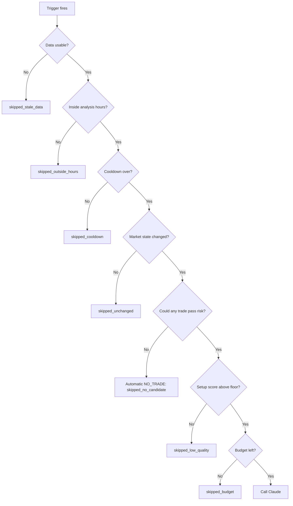

# AI Cost Strategy

Date: 2026-11-02
Status: Proposed under D025. Nothing is built yet, and no Claude call has been made by this project. Dollar figures are planning estimates from stated assumptions, not measurements.

Goal: run the Claude analyst for about **$20 a month** at normal activity, with a hard stop at **$40**, without weakening trade decisions.

The strategy in one line: **most of the saving comes from not calling Claude, not from making calls cheaper.** Apply the levers in this order: avoid the call, send less, get less back, then pay less per token. A cheaper model comes last.

## 1. Scope and Baseline

| Item | Position |
|---|---|
| Scope | Every planned Claude call. No code exists yet, so this shapes the design rather than auditing it |
| Platform | First-party Claude API, on the owner's computer |
| Traffic classes | Trade decisions, scheduled reviews, news classification, evaluation runs |
| Quality bar | **None exists yet.** Without an eval, savings cannot be told apart from worse decisions. Tradeoff levers are marked "needs an eval" |
| Baseline | Estimated. Replace with logged `usage` data from the first real week |
| Prices | [Pricing page](https://platform.claude.com/docs/en/about-claude/pricing), fetched 2026-11-02 |
| Measured expectations | [Cost and intelligence guide](https://platform.claude.com/docs/en/about-claude/models/optimizing-for-cost-and-intelligence), fetched 2026-11-02 |

List prices per million tokens:

| Model | Input | 5-minute cache write | 1-hour cache write | Cache read | Output |
|---|---|---|---|---|---|
| `claude-opus-5-5` | $4.00 | $5.00 | $8.00 | $0.20 | $20.00 |
| `claude-sonnet-5-5` | $2.00 | $2.50 | $4.00 | $0.10 | $10.00 |
| `claude-haiku-5-5` | $0.10 | $0.125 | $0.20 | $0.01 | $0.50 |

Batch requests cost 50% less on all of these.

## 2. Where the Money Goes

An analysis costs about **$0.10 to $0.12**, under the first-design assumptions in section 11.

- **Call count multiplies everything.** A 15-minute close on two assets is 192 events a day. Calling Claude on each would cost about $700 a month.
- **Output is the largest part of each call.** It is 67% to 76% of the cost, and it includes thinking, which is why effort matters.
- **Caching helps less here than in most apps.** Each input is mostly fresh market data that can never cache, and calls are spread out.

## 3. Ranked Levers

Ranked by savings ceiling, not application order. There is no usage data yet, so ceilings are relative.

| Lever | Type | Savings ceiling | Data source |
|---|---|---|---|
| Deterministic gates that avoid the call | Free win | Largest | Estimate |
| Tighter output | Free win | Medium | Estimate |
| Smaller input | Free win | Medium | Estimate |
| Lower effort | Tradeoff, needs an eval | Medium | Published benchmarks |
| Reuse results and Python-written summaries | Free win | Small to medium | Estimate |
| Batch for unattended work | Free win | Medium for evals, zero for live decisions | Published 50% |
| Prompt caching | Free win | Small, and can go negative | Calculated |
| Cheaper model for decisions | Tradeoff, needs an eval | Small in dollars at this budget | Calculated |
| News filtering | Free win | Small. Haiku is already very cheap | Calculated |

## 4. Stage 1: Avoid the Call

This is where the decisions already made pay off. Python builds the level catalogue (D009) and the risk engine exists before Claude does (D010), so the system can often answer without asking.

Every trigger still runs. It passes through these gates in order, and the first failure ends it. Each result is stored in `analysis_triggers`, so every avoided call is counted.

| Gate | How it saves | Default |
|---|---|---|
| Evidence gate | Live Claude analysis starts only after the rule baseline passes its promotion gate. Spend until then is zero | On |
| Analysis hours | Unattended recommendations are of little use to a single user, so analysis can pause overnight | Off until the owner sets hours |
| Cooldown | Limits repeat calls per instrument | 5 minutes |
| Change detection | Skips when trend, structure, levels, volatility regime, news and open trades are unchanged | On |
| **Viability pre-check** | Runs the risk engine on the best catalogue candidates, in both directions, before any call. If nothing can reach 2:1 after costs, the result is an automatic NO_TRADE with reasons | On |
| Quality floor | Claude reviews only setups the rule score considers worth reviewing | 60 of 100, to be set from backtest data |
| Budget | See section 10 | On |

The viability pre-check is the most valuable gate, because most candles in most markets have no valid trade. Claude's judgment is spent only where a real decision exists.

An automatic NO_TRADE is recorded like any other, attributed to the rule strategy. This matches the brief's rule that the system must be comfortable saying NO TRADE. Claude remains the reasoning engine for every setup that could actually trade.

Other ways to avoid calls:

- **Invalidation needs no Claude.** A close beyond a level is deterministic, so Python invalidates the signal and alerts. Claude is called only if a replacement setup passes the gates.
- **Active trades need no Claude.** Stops, targets and expiry are price checks.
- **The dashboard never spends money.** Viewing a page or refreshing shows the last stored analysis. The market summary is written by Python from structured data. A manual "analyse now" button shows its estimated cost first.
- **Reuse.** An identical snapshot hash reuses the stored result, recorded as `reused_result`.
- **No catch-up storm.** After the computer wakes, all missed triggers collapse into one per instrument, and only once data is healthy again.
- **Start narrow.** Run Claude on BTC alone until it proves its value. That roughly halves spend.
- **Sample during evaluation.** Measuring uplift does not need every candidate reviewed.

## 5. Stage 2: Send Less

Input hygiene is a free win. Target 4,500 fresh tokens for a decision, 2,000 for a review.

| Input | Rule |
|---|---|
| Timeframes | One line each for 1D and 4H. Detail only for the setup and confirmation timeframes. 1M only when refining an entry |
| Candles | Recent setup-timeframe bars only. Older history becomes a short statistical summary |
| Indicators | A decision-relevant subset per timeframe. All indicators across seven timeframes would be well over 100 values |
| Levels | The nearest 8 to 12 from the catalogue, not all of them |
| News | Top five clusters, headline and one-line summary |
| Previous analysis | Three lines plus IDs, sent only when relevant |
| Numbers | Rounded to tick size, or 2 to 3 decimals for indicators |
| Format | Compact rows with short stable keys, rather than verbose JSON |
| Deltas | Unchanged sections shrink to "unchanged since last analysis" |

Each analysis is stateless and single-turn, so there is no conversation history to grow. The agent-loop levers in Anthropic's guide do not apply.

## 6. Stage 3: Get Less Back

Output is the most expensive token, so this is the best per-call lever.

- **Two routes, two schemas.** `decision` carries the full 12-step output. `review` is a short market read that cannot create a trade.
- **Enumerations over prose.** Prefer `market_direction: "bullish"` to a paragraph saying so.
- **Word limits in the prompt, with an example.** "One sentence" for each step field, and 80 words for each explanation. Don't enforce these as hard schema limits, because a failed validation means paying for a retry.
- **Say it once.** Fields must not repeat each other.
- **`max_tokens` stays a backstop.** Anthropic's data shows tight caps cut work off without improving cost per solved task, and a truncated answer here is a failed analysis.

Keep each route's schema stable. Changing a structured-output format breaks the cache.

## 7. Stage 4: Pay Less per Token

### Caching

Use it carefully, because the usual advice assumes long agent loops.

| Situation, for a 3,000-token prefix on Opus | Cost |
|---|---|
| No caching, one call | $0.0120 |
| 5-minute write, one call, never read | $0.0150, a 25% **penalty** |
| Two calls at the same close, with caching | $0.0156 against $0.0240, saving 35% |
| 1-hour write, one call, never read | $0.0240, double the uncached cost |
| 1-hour write, 3 later calls within the hour | $0.0258 against $0.0480 uncached |

Decisions:

- Put an explicit breakpoint on the static system prompt, which must exceed the 512-token minimum.
- Run BTC then ETH one after the other at the same close, so the second reads what the first wrote. Concurrent calls miss.
- Share macro and news context as a second stable layer across the two assets.
- Start with the 5-minute lifetime.
- Choose the lifetime later from measured gaps between calls. If calls are hours apart, caching can be turned off for that route.
- Anthropic's 80% healthy cache-read figure is for agent loops. Mostly fresh market data will read far less, and that is not a fault.
- Timestamps go after the breakpoint. Verify with `cache_read_input_tokens`.

### Batch

Half price. Most batches finish within an hour, and any request not processed within 24 hours expires. Use it where nobody is waiting:

- Evals and prompt regression runs.
- Forward replay studies.
- Re-classifying stored news after a prompt change.
- Weekly performance write-ups.

Never use it for live decisions. Server-side fallback does not apply to batches.

### Premiums to Avoid

Do not set `inference_geo: "us"`, which costs 1.1×. Do not use fast mode, which costs 2×. Neither helps this workload.

## 8. Stage 5: Tradeoffs

These change what the model can do, so they need an eval and owner approval.

### Effort

**Start `decision` at `medium`,** Anthropic's recommended default for Opus 5.5. This replaces the earlier `high`.

Published figures on one coding benchmark:

| Effort | Solved | Cost per task |
|---|---|---|
| `low` | 87.4% | $0.11 |
| `medium` | 92.8% | $0.21 |
| `high` | 95.3% | $0.29 |

Coding results do not transfer directly. On research benchmarks, `low` scored 3.4 to 14 points below `medium`, so Anthropic's advice is to measure the model you ship. Do not use `low` for decisions without evidence.

`review` starts at `low`, because it cannot create a trade.

### Model

- **Decisions:** `claude-opus-5-5`.
- **News classification:** `claude-haiku-5-5` at `low`. Anthropic recommends it for high-volume work with checkable outputs, and the brief asks for it.
- **Sonnet 5.5 for decisions:** not now. It halves the per-token price, about $9 a month at the target volume. But Anthropic's data shows Opus at `low` matching Sonnet per solved task, so cheaper tokens are not automatically cheaper decisions. Revisit if spend regularly hits the cap.
- **Haiku triage before Opus:** not now. Deterministic gates do this job for free, and a cheap model must not silently discard good setups.

## 9. News Costs

Haiku is cheap enough that the priority is not over-engineering this.

- Rule-based filter first, by instrument and source, with no AI.
- Deduplicate into clusters, and classify each cluster once.
- Use headline and provider snippet only.
- Scheduled releases such as CPI come from official calendars and need no AI.

At 800 input and 200 output tokens per article, 300 articles a day cost about $1.64 a month, and 100 a day about $0.55.

Measured on 2026-11-11, once the owner's key was set: 41 Federal Reserve stories averaged 1,030 input and 105 output tokens, $0.00016 each on Haiku 5.5. The classifier does not cache its instructions, which are about 250 tokens, below Haiku's 512-token caching minimum anyway. Since D052 news links to eight coins, and Finnhub and Binance announcements can add stories once their keys are set. At 100 relevant stories a day that is about $0.50 a month.

## 10. Budget Guardrails

These cap the damage when something goes wrong, such as a bug that loops.

| Control | Default | Effect |
|---|---|---|
| Daily soft limit | 80% of $3.00 | Only `decision` calls run. Alert |
| Daily hard limit | $3.00 | New analyses stop. Alert |
| Monthly hard limit | $40 | New analyses stop until the month resets or the owner raises it |
| Provider spend limit | $50 a month | Set in the Claude Console, independent of the app |
| Dedicated workspace and key | One for this project | Costs stay attributable. The default workspace cannot hold a spend limit |
| Pre-call reservation | Estimated cost held before each call | Parallel calls cannot overshoot the cap |
| Circuit breaker | 3 consecutive failures | Pause and alert, instead of paying for retries |
| Retries | SDK default for transport errors, one for schema failures | No retry on refusal or truncation |
| Trigger idempotency | Unique `dedupe_key` | A restart cannot repeat a paid call |

Costs are computed from `ai_model_prices`, a dated table, so a price change does not rewrite history.

Development stays cheap too: tests use recorded responses and fakes, CI never calls the API, and any paid run needs owner approval with its cost stated first.

## 11. Planning Numbers

Estimates only. They rest on assumed volumes and token counts, and must be replaced by measured data.

Assumptions:

- A first-design call: 4,000 cached, 6,000 fresh and 4,000 output tokens.
- A target `decision`: 3,000 prefix, 4,500 fresh and 2,500 output tokens.
- A target `review`: 3,000 prefix, 2,000 fresh and 800 output tokens.
- Half of target calls hit the cache.
- 30.4 days a month.

| Scenario | Calls a day | Per day | Per month |
|---|---|---|---|
| Naive: every 15M close | 192 | $23.04 | $700 |
| First design | 40 | $4.19 | $127 |
| Target, quiet market | 4 | $0.22 | $6.50 |
| **Target, typical** | **10** | **$0.58** | **$17.70** |
| Target, busy market | 24 | $1.47 | $44.60 |

Add about $1 to $2 a month for news. A month made entirely of busy days reaches the $40 cap, which is intended.

Monthly cost by volume and average cost per call:

| Calls a day | $0.05 | $0.08 | $0.12 |
|---|---|---|---|
| 5 | $8 | $12 | $18 |
| 10 | $15 | $24 | $36 |
| 20 | $30 | $49 | $73 |
| 40 | $61 | $97 | $146 |

Measured on 2026-11-11 for the planned exit manager (docs/37). On 2020 to 2025 trades, its price checks fired about 2 times per open trade-day: about 20 a day at 10 open trades, before CHoCH, news and event checks. On Claude Haiku 5.5, the owner's choice for now, an exit check of about 2,300 input and 450 output tokens costs about $0.0005, so 20 a day is about $0.30 a month. The first real call, on 2026-11-11, used 606 input tokens, 1,194 written to the cache and 84 output tokens, for $0.00025, so 20 a day is about $0.15 a month.

## 12. Measurement

Spend is judged per completed decision, not per token.

The `/costs` dashboard shows:

- Spend today and this month against limits.
- Spend by route and model.
- Triggers by outcome, including how many calls each gate avoided.
- Cost per analysis and per approved recommendation.
- Tokens by type, including thinking and cache share.
- Gaps between calls, to choose the cache lifetime.
- Claude's uplift over the rule baseline, net of API cost.

Log `usage` on every call from the first one. `usage.output_tokens_details.thinking_tokens` shows what thinking costs.

**Check that gates are not hiding good trades.** Periodically measure how skipped setups would have performed. If `skipped_low_quality` setups do well, the floor is wrong. Saving money by missing good trades is not a saving.

## 13. Evaluation Plan

Needed before any tradeoff lever is applied.

- About 30 frozen market snapshots, including quiet, trending, conflicting and news-driven cases, plus a hard tail.
- Automated checks: schema, evidence IDs, level selection and consistency, plus owner review of a sample.
- Forward outcomes where available.
- One lever at a time, keep or revert. A cheaper setting that makes worse decisions gets reverted.

Estimated Batch cost: about $4 for 30 snapshots across three effort levels, or about $22 with five trials each. The owner approves this budget before it runs.

## 14. Levers Skipped

| Lever | Why |
|---|---|
| Compaction, context editing | Single-turn calls have no history |
| Tool search, programmatic tool calling | The analyst has no tools |
| Failure-driven escalation | Needs a reliable quality checker. Validators check structure, not judgment |
| Advisor or orchestrator models | One self-contained decision, so a coordinator adds cost |
| Task budgets | Designed for long agentic loops |
| Files API, code execution | Python already does the calculations |

## 15. Build Order

| When | Action |
|---|---|
| Now | Keep Claude out of Phases 0 to 5, as D010 already does. AI spend is $0 |
| Phase 3 | Viability pre-check exists, because it reuses the risk engine |
| Phase 6 | Haiku classification, with filtering and clustering first |
| Phase 7 start | Gates, budget, price table, usage logging, circuit breaker and dashboard, **before the first live call** |
| Phase 7 middle | Prompts within input and output targets. Measure a real week |
| Phase 7 end | Eval, then effort sweep. Choose cache lifetime from real gaps |
| Ongoing | Review spend monthly, and re-run after any model or prompt change |

## Sources

- [Claude pricing](https://platform.claude.com/docs/en/about-claude/pricing)
- [Optimizing for cost and intelligence](https://platform.claude.com/docs/en/about-claude/models/optimizing-for-cost-and-intelligence)
- [Batch processing](https://platform.claude.com/docs/en/build-with-claude/batch-processing)
- [Prompt caching](https://platform.claude.com/docs/en/build-with-claude/prompt-caching)
- [Rate limits and spend limits](https://platform.claude.com/docs/en/api/rate-limits)
- [Workspaces](https://platform.claude.com/docs/en/manage-claude/workspaces)
