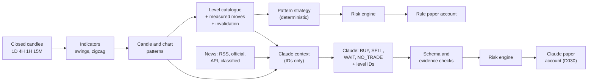

# Pattern Signal Plan

Date: 2026-11-03
Status: Increments 1 to 5 are built and tested, and the backtest results are below. Increment 9 waits for D033. Research: [26-PATTERN-RESEARCH.md](26-PATTERN-RESEARCH.md). Decisions: D030 to D034 in [17-DECISIONS.md](17-DECISIONS.md).

## Goal

Detect candle and chart patterns deterministically, turn confirmed patterns into trade setups with prices from Python, and let Claude judge those setups with news, so the system enters with the trend, with a stop and targets, or says NO TRADE.

No signal is perfect. The system's job is to trade only when trend, pattern, levels and news agree, to size every trade at 1% risk, and to measure itself honestly.

## Pipeline



Python produces every number. Claude reads pattern and level IDs, chooses a direction and levels by ID, and explains its choice. The risk engine validates both strategies the same way.

## Increments

| # | Increment | Depends on | Status |
|---|---|---|---|
| 1 | Candle patterns, rule version 2, with a prior-trend rule | Phase 2 | Done |
| 2 | ATR zigzag and chart patterns | 1 | Done |
| 3 | Catalogue levels for measured moves and pattern invalidation | 2 | Done |
| 4 | Pattern strategy and a pluggable backtest strategy | 3 | Done |
| 5 | History backtest, cost stress, random-entry benchmark, report and chart | 4, D034 | Done |
| 6 | Quant worker runs the new detectors live, and the dashboard shows them | 2 | Next |
| 7 | News sources: BLS calendar, SEC, Treasury, crypto RSS, then the API source | D032 terms checks | Next |
| 8 | Claude analyst: gates, budgets, context builder, prompt, validation, its paper account | API key, 6, 7 | After the key |
| 9 | Coin screening and suggestions | D033 approval | Waiting |

## Pre-Registered Strategy: `pattern_breakout` Version 1

Written before any result was seen. Changing any value below makes a new trial, which is counted and reported.

**Hypothesis.** On BTC and ETH perpetuals, a confirmed 1H chart-pattern breakout in the direction of both the 4H and 1D swing trend travels far enough to pay for a 2:1 trade after costs, and does better than random entries with the same trend filter and the same exits.

| Part | Rule |
|---|---|
| Data | Binance USD-M perpetuals, closed candles only. 1H setups, 4H and 1D trend, 15M fills (D034) |
| Pivots | ATR zigzag with k = 2.5 × ATR(14) on 1H |
| Patterns | Head and shoulders and inverse, double top and bottom, rectangle, ascending, descending and symmetrical triangle, rising and falling wedge, broadening, bull and bear flag. Rules in [25-PATTERN-RULES.md](25-PATTERN-RULES.md), rule version 2 |
| Trigger | A chart pattern whose breakout closes on the latest 1H candle |
| Trend filter | The breakout direction equals the swing trend on both 4H and 1D. A trend of none fails |
| Entry | Market, at the open after the breakout close |
| Stop | The pattern's invalidation level, plus 0.25 ATR, rounded away from entry |
| Targets | Up to three catalogue levels at least 2R from entry, nearest first. The catalogue adds the pattern's measured move at 1× and 2× its height. Exits are 50%, 30% and 20%, and the stop stays in place |
| Risk | Default profile: 1% risk, weighted 2:1 after costs, 100% exposure cap, leverage 1 |
| Positions | One at a time per instrument, as in the baseline engine |
| Expiry | 4 candles for an unfilled order |

**Trials.** Two, both declared now.

1. Trial 1: the rules above.
2. Trial 2: the same, but a candle pattern in the breakout direction must close within the last three 1H candles, ending at the breakout. This tests whether candles add value as confirmation.

## Evaluation

Method from [10-BACKTESTING.md](10-BACKTESTING.md).

- Period: 2020-01-01 to 2025-11-01. The holdout is refused by code (D029).
- Walk-forward folds of 24 months train, 6 months validate and 6 months test, rolled every 6 months with a 7-day embargo. Nothing is fitted, so the combined test folds are the main evidence and the full period is shown beside them.
- Costs at 1×, 1.5× and 2×.
- Benchmarks: buy and hold, and 20 seeded random-entry runs. Random entries pick 1H candles where 4H and 1D agree, trade in that direction, and copy the stop distance in ATR and the target multiples from a real signal.
- Breakdowns by instrument, direction, pattern type and fold.
- Promotion gate: at least 200 out-of-sample trades, a bootstrap interval for expectancy above zero, a profit factor above 1.2 at 1.5× costs, positive results in most folds, and a beat over the random benchmark. Parameter stability needs extra trials and is not tested in this run.

Claude is not in this test. Its training data contains these outcomes, so it is judged forward only (D030).

## Results

Run on 2026-11-03, each trial once, and run again to confirm identical numbers. Simulated results. A profitable backtest is not proof of future profitability. Reports: [BTC](reports/pattern-backtest-btc.md), [ETH](reports/pattern-backtest-eth.md). The interactive chart is `data/reports/pattern-backtest.html`, kept on this computer because it holds Binance data. Rebuild it with `uv run python scripts/render_pattern_chart.py` in `backend/`.

| Trial 1, 2020-01-01 to 2025-11-01 | BTC | ETH |
|---|---|---|
| Trades | 162 | 176 |
| Net P/L on 10,000, after costs | +2,476 | +2,225 |
| Expectancy, with 95% interval | +0.16R, -0.11 to +0.44 | +0.14R, -0.12 to +0.40 |
| Profit factor | 1.20 | 1.16 |
| Maximum drawdown | 10.5% | 15.1% |
| Expectancy at 2× costs | +0.09R | +0.16R |
| Random entries, same trend filter and exits | +0.11R mean | +0.07R mean |
| Walk-forward test folds | 74 trades, +0.08R | 82 trades, +0.28R |
| Buy and hold, no costs | +1,424% | +2,879% |

What this says:

- Both coins made money in simulation after costs, but neither interval excludes zero, so luck is not ruled out.
- On BTC, random entries with the same trend filter and exits did nearly as well. Most of the result comes from trading with the trend, not from the patterns.
- ETH looked better out of sample and beat the random benchmark in its test folds, on only 82 trades.
- Longs made money and shorts lost on both coins, in a period when both rose more than tenfold. That fits trend exposure more than pattern skill.
- Symmetrical triangles lost on both coins, as Bulkowski's rankings would suggest. Dropping patterns because of this table would be fitting the past, and would need fresh data to test.
- Trial 2's candle confirmation did not clearly help.
- The promotion gate is not met: 74 and 82 out-of-sample trades, against 200 required.

Decision: nothing is tuned from these results. Next, the strategy runs forward in paper trading as the 1H rule baseline that Claude's account (D030) is measured against.

### Holdout Year

The single holdout run, 2025-11-01 to 2026-11-01, on 2026-11-04 (D037). Full table: [pattern-holdout.md](reports/pattern-holdout.md).

| Normal costs | BTC | ETH |
|---|---|---|
| Version 1 | 23 trades, +0.30R, +635 | 23 trades, -0.33R, -700 |
| Version 2, skipping the most volatile quarter | 22 trades, +0.17R, +332 | 18 trades, -0.33R, -558 |
| Buy and hold | -29.2% | -41.4% |

On a year nothing was tuned on, version 1 was roughly flat across both coins while holding lost heavily. The volatility rule from 2020 to 2025 did not hold up, so it is dropped. Neither version has a proven edge.

## What Claude Will Receive

The context builder in [07-CLAUDE-AI-ANALYST.md](07-CLAUDE-AI-ANALYST.md) gains pattern evidence. Claude reads no chart images (D035). Each pattern arrives as numbers from `pattern_detection/describe.py`, so its shape can be judged the way a person judges a picture.

The real numbers for BTC trade 95, the head and shoulders of 2023-03-07, computed from stored candles. Distances are in ATR at the breakout, where 1 ATR was 70.88 USDT:

```
pat:01 head_and_shoulders 1h bearish, breakout close 2023-03-07 11:59 UTC
  size        38 candles, height 4.35 ATR (1.38%), after a 5.36 ATR rise into it
  shape       shoulders 0.07 ATR apart, head 0.56 ATR above them,
              neckline rising 0.5 ATR per 10 candles
  breakout    closed 0.25 ATR below the neckline, body 27% of the candle,
              volume 1.16x the 20-candle average
  room        2.97 ATR back to invalidation; measured moves 4.09 and 8.44 ATR away
  points      left shoulder 22,555 (38 candles ago), neckline 22,240.1 (33),
              head 22,594.5 (20), neckline 22,307.9 (14), right shoulder 22,550 (8)
  levels      the neckline, invalidation and both measured moves, each by catalogue ID
```

A person would read this as clean shoulders and a confirmed break, but a shallow head and a weak breakout candle. These are the judgments Claude makes in `pattern_assessment`, citing `pat:01`.

Levels keep their catalogue IDs, and the new kinds are `measured_move` and `pattern_invalidation`. Claude can choose a pattern's levels, a different catalogue level, WAIT or NO_TRADE. It cannot write a price.

## Risks and Assumptions

| Risk | Handling |
|---|---|
| Overfitting to history | Two declared trials, no tuning, walk-forward folds, cost stress, random benchmark |
| Patterns are subjective | Written rules, versioned. A label means a rule fired |
| Weak published evidence | Expect many NO TRADE results, and possibly no edge |
| 15M fills are coarser than 1M | Stop-first rule makes results worse, never better |
| Survivorship | BTC and ETH were chosen with hindsight. Stated in every report |
| Little disk | 2.9 GB free after the history load. No 1M history |
| Claude cost | Gates and budgets from D025 stay. Nothing is spent until the owner adds a key |
